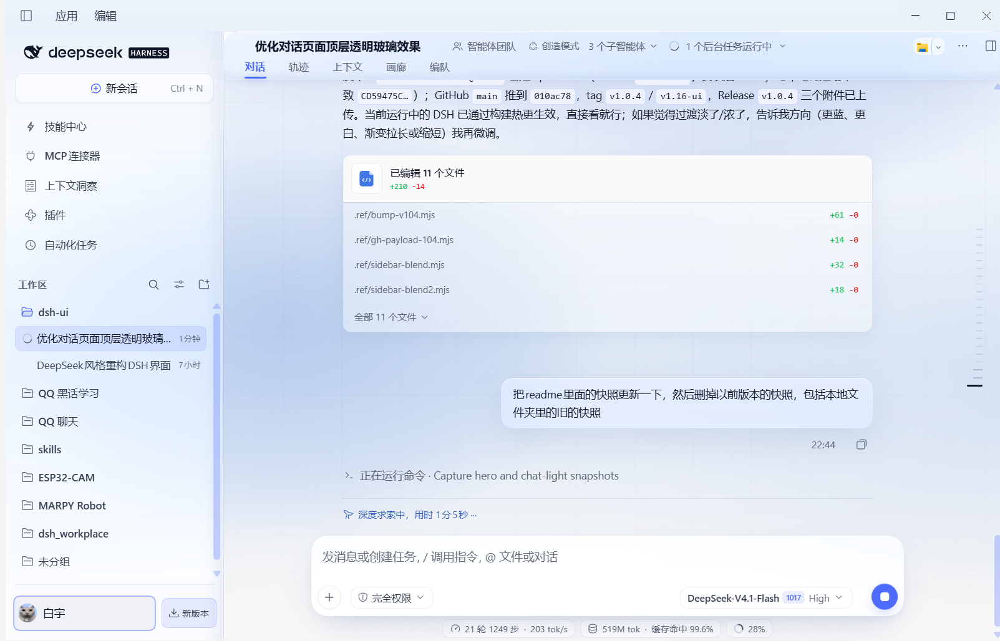
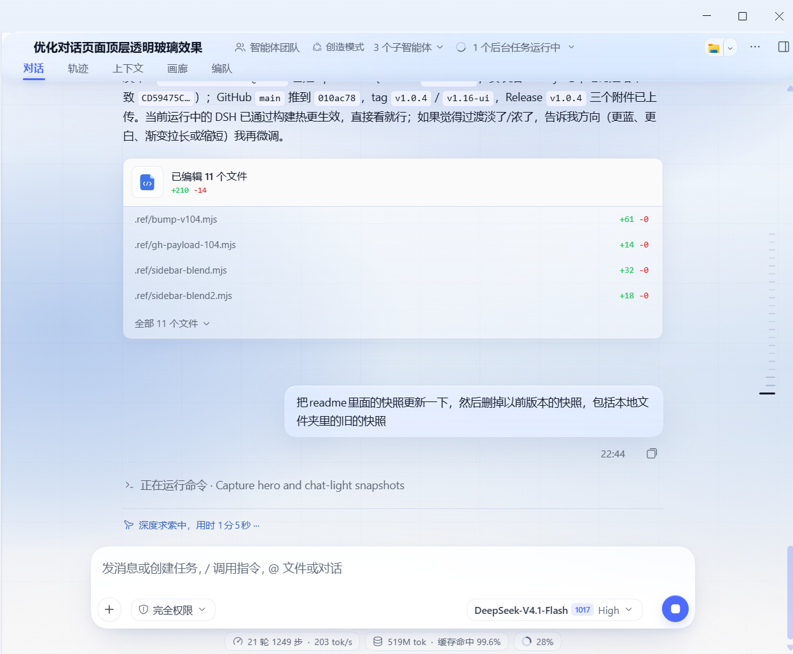
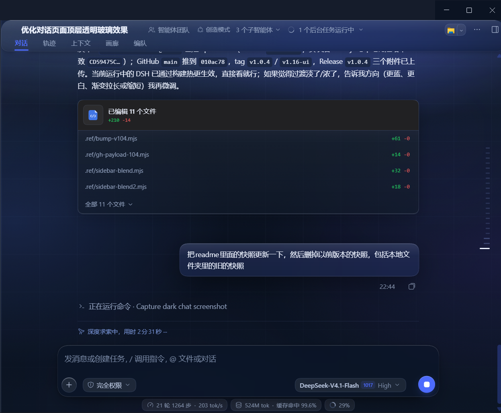
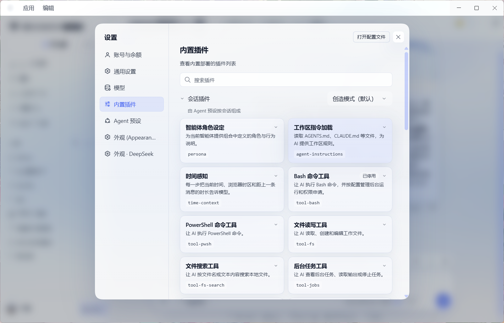
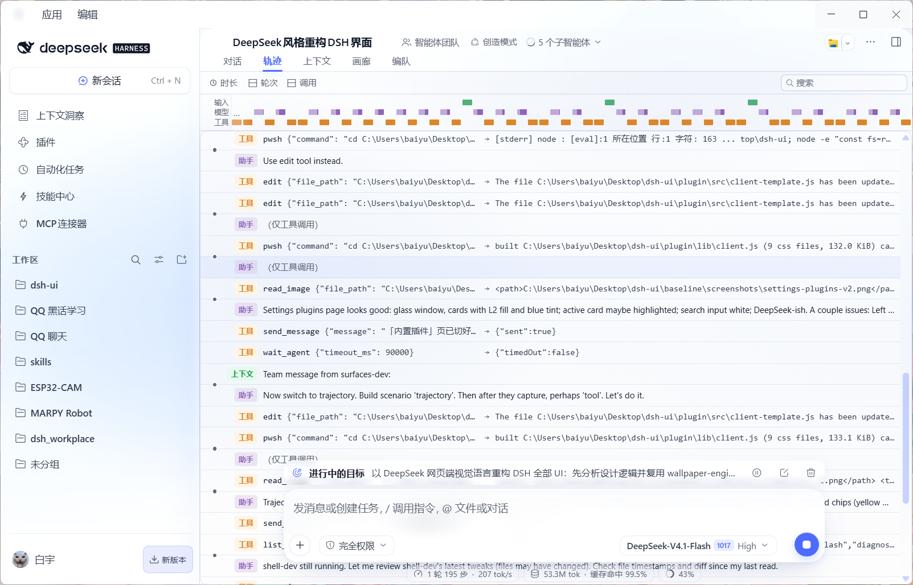
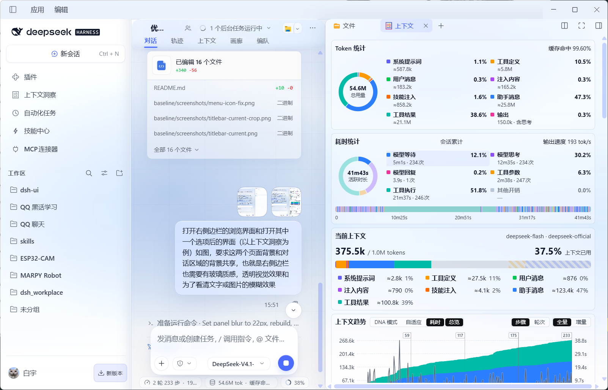
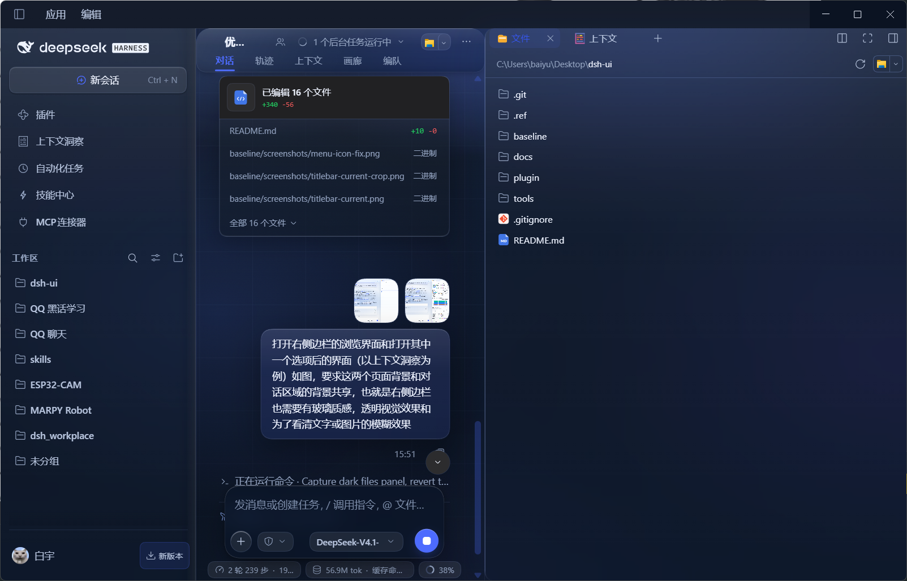

# dsh-skin-mistblue（雾蓝）

[](https://www.npmjs.com/package/dsh-skin-mistblue)
[](LICENSE)
[](https://github.com/HewangLan0511/dsh-ui/releases)

> 把 DeepSeek 的海雾，做成 DSH 的一层玻璃。

DeepSeek Harness（DSH）的玻璃质感皮肤：以 DeepSeek 网页端（deepseek.com）的视觉语言为基准，
雾蓝渐变氛围背景 + 分层柔光玻璃，弹窗 / 显示卡 / 详情卡按可读性分级加雾，
浅色与深色同构，设置页中英双语并跟随 DSH locale。

**版本 `1.0.4` · MIT · 已发布 npm：[`dsh-skin-mistblue`](https://www.npmjs.com/package/dsh-skin-mistblue)**



| 浅色 · 对话 | 深色 · 对话 |
|---|---|
|  |  |

## 特性

- **玻璃层级（L1 / L2 / L3）**：内容面、卡片、弹窗按可读性分级 `fill + backdrop-filter`；
  大面一律只用一层霜（`::before` 唯一载体），避免固定定位祖先把 `backdrop-filter` 撕成灰块。
- **氛围背景**：DeepSeek 蓝 `#4D6BFE` 雾蓝渐变 + 75px 极淡网格；支持壁纸共存（可选）。
- **对话页悬浮玻璃 header**：会话标题 / 智能体 chips / tab 行收成一条内缩 18px 圆角玻璃条，
  与输入卡同一套材质语言。
- **右侧边栏共享背景**：文件浏览器、上下文洞察不再是叠了多层白板，玻璃只保留一层，
  氛围直接透上来。
- **Windows 原生标题栏统一**：标题栏 overlay、菜单条、网页侧标题栏三层同色同材质，
  收起态图标几何交回宿主、蓝点隐藏、tooltip 不再被玻璃染色。
- **悬停 tooltip 玻璃化**：原生 tooltip 与图表悬停卡统一高填充玻璃（94% / 96%），
  文字可读优先，保留 16px 霜 + 釉 + 发丝边。
- **文档预览不透明纸面**：文档 / 文本 / PDF 预览与差异视图使用实底纸面（`--dsg-doc-paper`），
  含预览的面板与 dockkit 容器一并做实 —— 预览文字不会与对话区叠字。
- **左侧面板列表增强**：`插件 / 上下文洞察 / MCP 连接器 …` 支持按住**拖动换位**
  （顺序存 localStorage 并自动重放）；已打开的选项**再点一次**通过
  `layout.selectPanel(null)` 返回会话。
- **拖动性能**：按下分隔条即卸掉霜与超大投影；拖动期间左右分栏用
  `transition: width 90ms linear` 有界跟随（快速甩动摊到多帧、不瞬移），
  dockkit 的慢过渡与滚动锚定同时关闭；松手宽度贴合光标，静止外观不变。
- **i18n**：设置页文案动态读取 DSH `locale` 服务 / `<html lang>` / `navigator.language`，
  默认中文，切换即时重渲染（不缓存）。

| 设置 · 外观 | 轨迹 |
|---|---|
|  |  |

| 右栏 · 上下文（浅） | 右栏 · 文件（深） |
|---|---|
|  |  |

## 安装

### 从 npm 安装（已发布 `1.0.0`）

```powershell
npm install dsh-skin-mistblue
```

> 实际安装到 DSH 时，在**设置 → 插件 / 插件市场**或 `plugin_manager` 里以 bundle 形式安装
> `dsh-skin-mistblue`（包内已声明 `dsh.bundle.patch`），装完设置页出现「外观 · 雾蓝」。
> 只下载 tarball：`npm pack dsh-skin-mistblue`。

- **npm 包页**：<https://www.npmjs.com/package/dsh-skin-mistblue>
- **GitHub**：<https://github.com/HewangLan0511/dsh-ui>
- **Release 附件**（tgz / src zip / SHA256SUMS）：
  <https://github.com/HewangLan0511/dsh-ui/releases/tag/v1.0.0>

### 本地开发（本仓库）

```powershell
node tools/build-plugin.mjs          # 内联 src/styles/*.css -> plugin/lib/client.js
# 然后用 DSH plugin_manager install_bundle，target 指向本仓库 plugin/ 绝对路径
```

已安装为链接模式时，改 `plugin/src/styles/*.css` 后重新 build，
运行中的页面会 HMR 热更新（非 development 启动的 DSH 需重启）。

### 安装到新环境

```powershell
# 1) 取包（npm 或 Release 附件）
npm pack dsh-skin-mistblue            # 或从 GitHub Release 下载 tgz
# 2) DSH 插件管理页 / plugin_manager 安装该 bundle
#    或 npm install dsh-skin-mistblue 后按包内 dsh.bundle 入口加载
```

## 设置

设置 → **外观 · 雾蓝**：

- 配色：浅色 / 深色 / 跟随系统（默认浅色，DeepSeek 参考图基准）
- 氛围背景：极光 / 轻雾 / 关闭
- 玻璃透明度、模糊强度、动效开关

## 兼容与边界

- **Windows 桌面端**：原生标题栏（`titleBarOverlay`）与网页侧标题栏按同一实体色绘制；
  自定义标题栏按钮的 tooltip 通过 `:has([role='tooltip'])` 只在浮层挂载时抬升层叠。
- **不支持 `backdrop-filter`** 的环境：自动降级为高填充实体面（`data-dsg-fallback`），不出现"灰玻璃"。
- **悬停预览卡（HoverCard）** 保持宿主材质（文件/图片预览玻璃化会洗白），不在皮肤覆盖范围内。
- 皮肤只改样式层，不修改 DSH 宿主 HTML / 行为；卸载即恢复原样。

## 仓库结构

```
plugin/               插件 dsh-skin-mistblue（本项目主要产物）
  src/styles/         00 基础+玻璃引擎 · 10 壳层 · 20 左栏 · 30 输入区 · 35 Hero
                      40 内容 · 50 浮层 · 60 设置 · 95 插件设置页
  lib/client.js       构建产物（内联 CSS + React 设置页），勿手改
  lib/index.js        host 半部（bundle 行注册）
  locale/             zh.json / en.json
  cordis.patch.yml    bundle 行（id mistblue）
tools/                构建 / 截图 / 提取 / 回归 / 发布脚本
docs/                 设计规格、玻璃引擎规格、表面清单、实现契约、逐轮报告
baseline/             施工前快照（可回滚点 baseline-v0）
```

## 开发

```powershell
node tools/build-plugin.mjs          # 构建 client（11 个 CSS 内联）
node tools/test-plugin-logic.mjs     # resize guard + i18n 回归（9/9）
node tools/tooltip-preview.mjs       # tooltip 玻璃验证台（真实 CSS 层叠）
node tools/release.mjs               # 构建 + npm pack + 源码 zip + 校验和（dist/）
```

回滚：

```powershell
git checkout baseline-v0 -- .        # 回到施工前快照
# 或按 docs/OPERATIONS.md 卸载 bundle
```

## 文档

- [交付报告（逐轮根因/修法/截图）](docs/REPORT.md)
- [DeepSeek 视觉规格](docs/DESIGN-SPEC.md) · [玻璃引擎规格](docs/GLASS-SPEC.md)
- [DSH 表面/选择器清单](docs/SURFACE-MAP.md) · [最终取舍](docs/FINAL-DECISIONS.md)
- [实现契约](docs/UI-CONTRACT.md) · [构建/安装/回滚](docs/OPERATIONS.md)
- [命名决定](docs/NAMING.md) · [发布清单](docs/RELEASE.md) · [CHANGELOG](CHANGELOG.md)

## 版本

`1.0.0` — 汇总 v1.0-ui → v1.12-ui 十二轮迭代（玻璃引擎、悬浮 header、右栏、拖动性能、
中文设置、改名雾蓝、收起态标题栏、tooltip 玻璃化、文档预览纸面、拖动流畅化）。
`1.0.1` — 左侧面板列表拖动换位 + 二次点击返回（第十三轮，`v1.13-ui`）。
`1.0.2` — 拖动换位改用原生 HTML5 DnD，修复实机拖不动/异位（第十四轮，`v1.14-ui`）。
`1.0.3` — 设置配色切换、MCP 页顶部白块/推荐卡黄边、拖动与选字时的竖线虚影（第十五轮，`v1.15-ui`）。
`1.0.4` — 左栏顶部与标题栏/主体之间的颜色过渡柔和化（第十六轮，`v1.16-ui`）。
逐版本说明见 [CHANGELOG.md](CHANGELOG.md)。

## License

[MIT](LICENSE) © 2026 HewangLan0511
