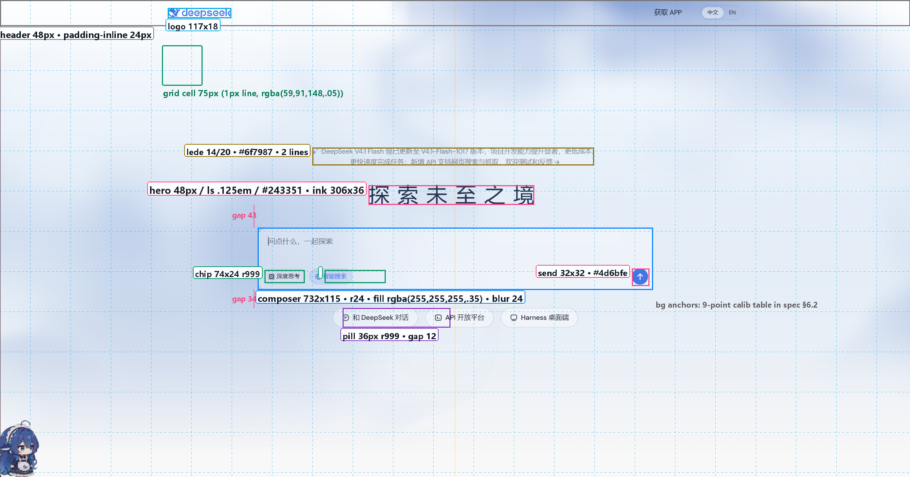
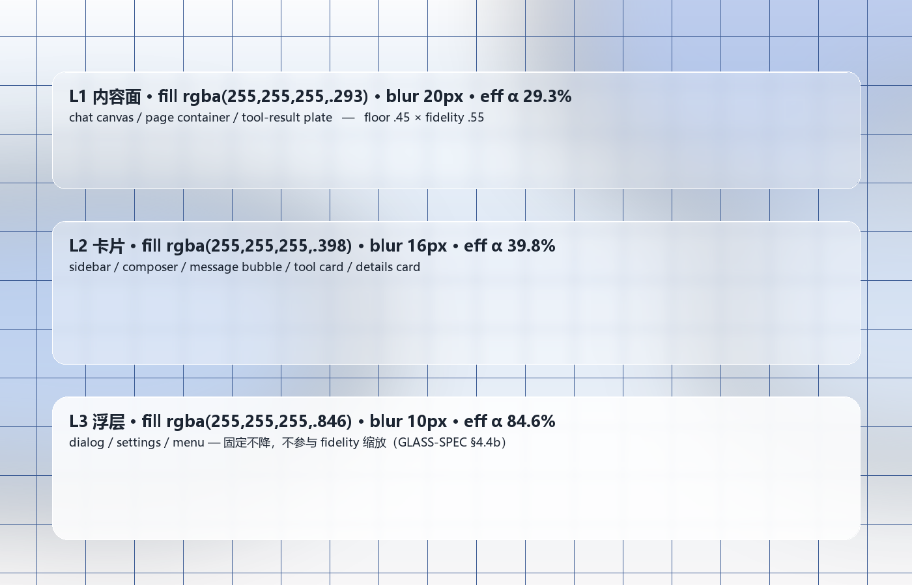
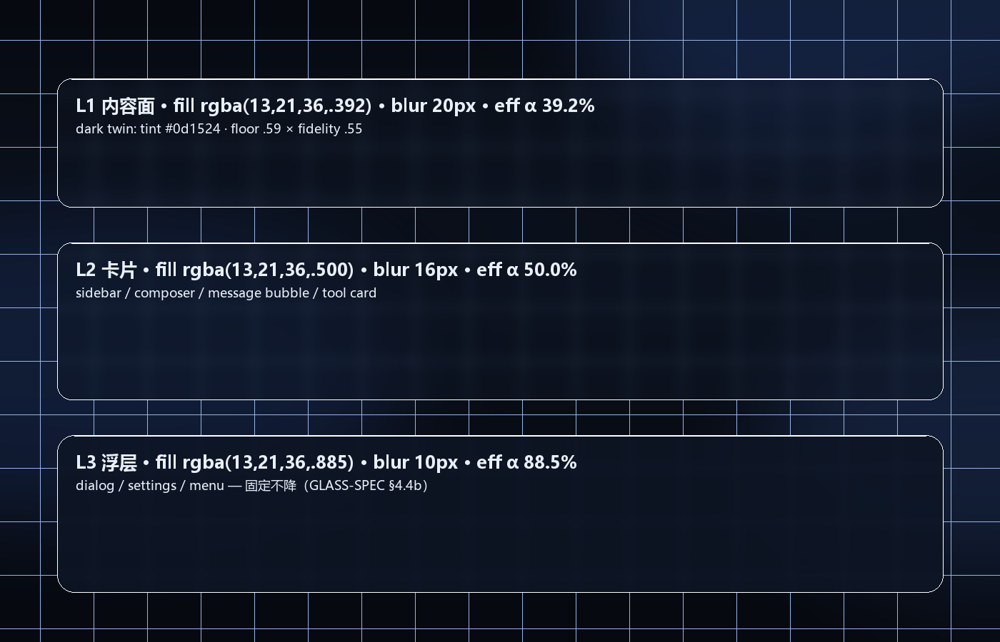
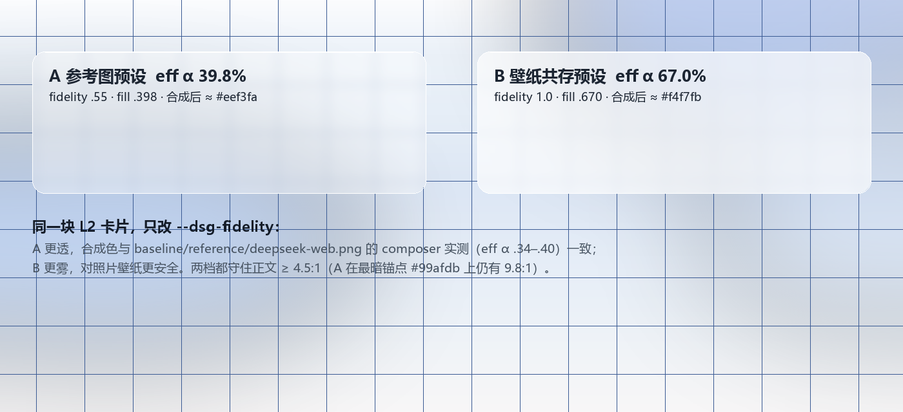

# DSH × DeepSeek Web · 视觉设计规格（DESIGN-SPEC）

> 代号 **DSG · DeepSeek Glass**
> 目标：以 `baseline/reference/deepseek-web.png`（deepseek.com 网页端首屏）的视觉语言为基准，重做 DSH（DeepSeek Harness）桌面 / Web GUI —— 三栏主壳、设置窗口、弹窗、菜单、tooltip、工具卡、详情侧栏都适用，不是只复刻一个首页。
>
> | 项 | 值 |
> |---|---|
> | 基准参考图 | `baseline/reference/deepseek-web.png` · 2529×1329 px · DPR 1.5 → **1686×886 CSS px** |
> | 现状截图 | `baseline/screenshots/current-ui.png` · 1603×1028 px（深色、不透明、无氛围层） |
> | 现有 token 源 | `baseline/ui-theme/design_platform.css`、`base.css`、`gradient_shadow_text.css`、`scrollbar.css`、`shiki.css` |
> | **玻璃引擎契约** | **`docs/GLASS-SPEC.md` §4.4（三级表）/ §4.4b（A·B 两预设 + 氛围层 DOM 契约）/ §6.2 & §6.4（变量契约）/ §3.4（真实 DOM 对齐）—— 本文件 §6.2、§7、§9.4-A 逐条引用，不另立一套** |
> | 落点清单 | `docs/SURFACE-MAP.md`（每个面用哪个选择器、模糊挂 `::before` 还是元素本身） |
> | 主视觉基准 | **浅色**；深色是同一套逻辑的「暗色玻璃变体」，供 DSH 现有 dark 偏好使用 |
>
> 标 `📐` = 从参考图逐像素实测；标 `🎛` = 设计取值（实测取整到设计栅格，或为推广到 DSH 而新增）。

---

## 0. 这份文档怎么用

1. **写样式的人**：§9.4-A 是玻璃契约（照 GLASS-SPEC 粘），§9.4-B 是本文件新增的设计变量；§8 逐组件给选择器与 CSS；§12 是截图验收标准。
2. **做玻璃引擎的人**：§7 引用 GLASS-SPEC，不重复定义公式；本文件只补「参考图档（A）怎么落在视觉上」和「55 个表面分别归哪级」。
3. **做验收的人**：§2.4 的 9 点取样表 + §12 的 15 条，全部可截图后跑脚本量化。
4. 本文件里「柔和」「空气感」一律已翻译成 alpha / blur 半径 / ΔE 容忍度 —— 不要再凭形容词争论。

---

## 1. 设计原则（每条都带可执行判据）

| # | 原则 | 可执行判据 |
|---|---|---|
| P1 | **背景是主体，界面是贴在背景上的玻璃**。首屏 65% 以上面积是氛围层，没有实体面板。 | 空态首屏：氛围层可见面积 ≥ 65%；不透明元素面积 ≤ 8%。 |
| P2 | **分层靠「雾」，不靠「线」**。用 fill alpha + blur 区分层级，1px 实线只留给输入框/表格这类必须的控件。 | 相邻两级 effAlpha 差 ≥ 0.10（29.3→39.8→84.6 ✅）；同层内边框 alpha ≤ 0.20。 |
| P3 | **大留白 + 单一视觉焦点**。一屏只有一个展示级字号。 | 同屏 ≥ 40px 的文本块数量 = 1；其余 ≤ 32px。 |
| P4 | **文字永远比玻璃重要**。先保正文 4.5:1，再谈通透。 | 见 §7.3 的安全性证明；任何玻璃面正文对比度 ≥ 4.5:1。 |
| P5 | **材质统一，表面分级**。全应用只用一种釉色（浅 `#ffffff` / 深 `#0d1524`），靠三级 alpha 拉开远近。 | 玻璃 tint 只有 1 个；出现第二种带色玻璃 = 违规。 |
| P6 | **中文标题要「慢」**：重 600、宽字距、行高 1.25，让 4–8 个字撑满版面。 | Hero 字距 0.04em（宋体）/ 0.125em（黑体），字重 ≥ 600。 |
| P7 | **动效只做「出现」，不做「表演」**。140–320ms，位移 ≤ 12px，缩放 ≤ 1.02。 | 无 > 400ms 的交互动效（氛围层静态，无动画）。 |

---

## 2. 参考图量化基线（📐 全部实测）

### 2.1 测量方法

Pillow 逐像素扫描：① 墨迹包围盒（阈值 luminance < 100/150 分离标题与浅灰副标题）② 亮度一阶差分定位面板边缘 ③ 高通滤波 + 峰值检测求网格周期 ④ 双背景反解 alpha。所有数值换算到 CSS px（÷1.5）。

### 2.2 DPR 标定（为什么是 1.5）

三个独立锚点交叉验证，都落在 DPR = 1.5：

| 锚点 | 实测（device px） | ÷1.5 | 结论 |
|---|---|---|---|
| 发送按钮蓝色圆 | 45×45（含 AA 约 48） | 32 | DeepSeek 标准 32px 圆形按钮 ✅ |
| 副标题行距（第 1 行墨顶 → 第 2 行墨顶） | 31 | 20.67 | 14px/20px 正文 ✅ |
| composer placeholder 墨高 | 26（含逗号下延） | 17.3 | 16px 字号 ✅ |

→ **视口 1686×886 CSS px**，后文所有 `px` 均为 CSS px。

### 2.3 布局测量表



| 元素 | CSS 位置 / 尺寸 | 备注 |
|---|---|---|
| 顶栏内容带 | y 0–48；logo 左缘 x=311，logo 117×18 | logo 垂直中心 y=24 → 顶栏 48，内容居中 |
| 顶栏右侧 | 「获取 APP」+ 中文/EN 分段控件，右缘 x≈1375 | 左右留白 311/311 → 内容容器 ≈1064 居中 |
| 副标题 lede | 两行，墨迹 y 274–307，行高 20，字号 14 | 居中，行宽 ≈522 |
| **Hero 标题** | 墨迹 x 683–989（宽 306）、y 344–380（高 36.7） | 6 字，**推进 54/字**，字距 ≈6px |
| lede → 标题 | 307 → 344 = 37 | |
| 标题 → composer | 380 → 423 = 43 | |
| **Composer** | x 477–1209（732×115），r≈24 | 居中；宽 = 视口 43.4% |
| composer placeholder | 墨迹 y 439–456，左内边距 ≈20 | 16px |
| 工具条 chips | chip 高实测 ≈24–28（边界受限），y 501–525 | 「深度思考」白釉、「智能搜索」蓝釉 |
| 发送按钮 | 32×32，中心 (1184, 513)，距右内边距 ≈13 | |
| composer → CTA 胶囊 | 538 → 572 = 34 | |
| CTA 胶囊行 | 高 36、r999、y 572–608、行宽 x 635–1053（418 居中） | 3 个，间距 ≈12 |
| 页面底部 | y 833 起近中性白 `#f6f6f7` | 雾气向下收尾 |

> 结构一句话：**顶栏 48 / lede 274 / 标题 344 / composer 423 / 胶囊 572**，视觉重心在 y≈45%，上下留白比 1 : 1.4。

### 2.4 氛围层 9 点取样（校准锚点）

复刻背景的**验收基准**。实现后在同样 9 个 CSS 坐标取样，应 ΔE₀₀ ≤ 3（或单通道 ≤ 6/255）：

| y \ x | 80 | 267 | 467 | 667 | 843 | 1000 | 1200 | 1400 | 1600 |
|---|---|---|---|---|---|---|---|---|---|
| **20** | `#fcfdfe` | `#fcfdfe` | `#fcfdfe` | `#fcfdfe` | `#c5d2eb` | `#b5c5e5` | `#99afdb` | `#b5c5e5` | `#f2f5fb` |
| **120** | `#f2f7fc` | `#f3f7fc` | `#f3f7fc` | `#ecf2f9` | `#dce5f4` | `#cedbef` | `#d3def1` | `#d0dcf0` | `#d8e2f3` |
| **253** | `#eaf1f9` | `#eaf1f9` | `#e6eef8` | `#e4ecf7` | `#e8eff8` | `#eaf1f9` | `#e7eff8` | `#e7eff8` | `#e4ecf7` |
| **413** | `#d6e2f3` | `#c8d7ee` | `#bbcde9` | `#d6e2f3` | `#dde7f5` | `#e5eef8` | `#e5eef8` | `#e5eef8` | `#e5eef8` |
| **547** | `#dbe6f3` | `#cad8ed` | `#c0d0ea` | `#d6e1f1` | `#e5edf7` | `#e6eef7` | `#e6eef7` | `#e6eef7` | `#e6eef7` |
| **700** | `#d9e2f0` | `#dae3f0` | `#dae3f0` | `#e5ecf4` | `#ecf2f7` | `#edf2f7` | `#edf2f7` | `#edf2f7` | `#ebf0f6` |
| **833** | `#f6f6f7` | `#f6f6f7` | `#f6f6f7` | `#f7f6f8` | `#f8f7f8` | `#f8f7f8` | `#f8f7f8` | `#f8f7f8` | `#f8f7f8` |

读法：**右上 y=20/x=1200 有强蓝雾核 `#99afdb`；左中 x=467/y=413–547 有第二条雾带 `#bbcde9`–`#c0d0ea`；底部收成中性暖白 `#f6f6f7`；顶部中央近纯白 `#fcfdfe`**。这四项是 §6 背景 CSS 的考核点。

### 2.5 网格（📐 硬数值）

- 周期：高通峰 device x = 84, 196.5, 309, 421.5, 534, 646.5, 759 → 间距 **112.5 device = 75 CSS px**
- 线宽 1 CSS px；格线相对局部底色下沉 ≈ 4/255 → 反解 alpha ≈ **0.03**
- 面显示意图：全屏，但被雾气与顶部白光削弱，底部 20% 几乎不可见

### 2.6 关键元素实测色

| 元素 | 实测 | 说明 |
|---|---|---|
| Hero 标题墨色 | `#243351`（中位 `#253451`） | 深蓝板岩，非纯黑 |
| 副标题 | 最暗 `#717a85`，感知 `#6f7987` | |
| placeholder 墨 | 最暗 `#1e232c` | 近正文黑，靠字号/字重弱化 |
| 品牌蓝（发送按钮 / 字标 / 智能搜索） | `#4176e6` **三处一致** | 与 DSH 现有 `--dsw-static-deepseek-500` 同值；官方品牌 `#4D6BFE`（见 §3.1） |
| composer 面板 | **`rgba(255,255,255,0.34–0.40)`**（4 点双背景反解） | 见 §7.3；与 GLASS-SPEC §4.4b「实测 0.35–0.40」一致 |
| `智能搜索` chip | 蓝釉 `rgba(77,107,254,.10)` + 蓝字 | 选中态 |
| CTA 胶囊 | 白釉 ≈`rgba(255,255,255,.62)`，边 ≈`rgba(90,115,160,.18)` | 边比底**暗**，不是白边 |
| 底部 | `#f6f6f7` / `#f8f7f8` | 中性收尾 |

### 2.7 字体判定 —— 一处必须纠正的事实 ⚠️

任务简报写「参考图里中文大标题用的是宋体/衬线风格」。**放大到 4× 逐笔画看，与图不符**：

- 证据：原始 2529×1329 裁 x 1180–1500 / y 440–590 后 ×4（同法可复现：`PIL.Image.crop(...).resize(..., LANCZOS)`）
- 判据：`未` 的两横、`至` 的三横、`境` 的 `土`，**笔画粗细一致、收笔是平切矩形、无三角顿笔、无衬线装饰**；`之` 的捺尾平切上挑，不是宋体燕尾。
- 结论：参考图是**粗黑体（无衬线）**，字重 600–700（Source Han Sans / Noto Sans SC / PingFang SC 一类），48px、letter-spacing ≈6px（0.125em）。
- 自检：单字墨宽 37、墨高 36.7、推进 54 → 去字距后 em≈48，墨高/em = 0.76（黑体典型值；宋体同字号会到 0.88 且横细竖粗）。

**处理方式**：两套都给出（§4.2）。DSH 的 Hero **默认走衬线栈**（满足项目「东方气质」意图），保留一行切回「1:1 复刻参考图」的粗黑栈。这是明确的设计选择 + 可回退的工程量，不是含糊。

### 2.8 与 DSH 现状（current-ui.png）的差距

| 维度 | 现状 | 目标 |
|---|---|---|
| 画布 | 纯 `#151517` 平面，无氛围层 | 浅色雾蓝氛围层 + 75px 网格 + 3 处雾核（§6） |
| 层级 | 靠 1px 边线 + 亮度差（`#1b1b1c`/`#212123`） | 靠 effAlpha（29.3/39.8/84.6）+ blur（区间见 §7.2） |
| 圆角 | 8/12/16 为主 | 10/16/20/24，composer 24，窗口 24，胶囊 999 |
| 顶栏 | 系统菜单 / 标题 / 操作三段，无玻璃 | 52px 一体顶栏，L2 玻璃，只留 logo + 标题 + 3 个动作 |
| Hero | 无（直接对话） | 空态 Hero：48（clamp 40–60）+ 20 lede + composer + 3 胶囊 |
| 字号 | 14 正文 / 13 小字 | 8 级阶梯（48/32/24/20/16/14/12/11） |
| 阴影 | 深色下几乎不可见 | 三级 bevel（顶光 + 发丝边 + 外投影） |
| 主色 | 只在发送按钮/高亮 | 品牌蓝成为唯一强调色：CTA、选中芯片、链接、focus |
| 密度 | 侧栏 340、行高紧 | 侧栏 264、行高 1.71、gutter 8、面板内边距 16/20 |

---

## 3. 色彩系统

### 3.1 品牌蓝阶

参考图三处品牌蓝实测都是 `#4176e6`（= DSH 现有 `--dsw-static-deepseek-500`），官方品牌值是 `#4D6BFE`。两者同色相邻明度档。**决策**：CTA / 链接 / 选中态用 `#4d6bfe`（品牌真值），玻璃上的图标 / 次级强调 / 既有 DSH token 保留 `#4176e6`。

```css
/* 唯一的强调色：只允许出现在 CTA、选中芯片、链接、focus ring、发送按钮 */
--dsg-blue-50:  #eef3ff;   /* 选中芯片底、链接 hover 底 */
--dsg-blue-100: #dfe8ff;
--dsg-blue-200: #c3d2ff;
--dsg-blue-300: #9fb4ff;   /* 深色主题浅蓝字 */
--dsg-blue-400: #7b93ff;   /* 深色主题链接 */
--dsg-blue-500: #4d6bfe;   /* ★ 品牌主色（CTA 填充） */
--dsg-blue-600: #3d59e8;   /* CTA hover */
--dsg-blue-700: #3047c9;   /* CTA active */
--dsg-blue-800: #25389e;
--dsg-brand-ink: #2f49d9;  /* 浅底蓝字，4.6:1 on #eef3ff */
```

### 3.2 中性 / 文字（浅色）

**两层文字色，不要混用**：① `--dsg-ink-*` 是「墨阶」（含 Hero 标题实测色）；② `--dsg-label-1..4` 是「内容语义 ramp」，**A 档必须用深一档的 ramp**（GLASS-SPEC §4.4b guard #3：沿用原生浅灰在 A 档会掉到 3.1–4.39:1）。

```css
/* 墨阶：Hero / 展示文本 */
--dsg-ink-950: #131a26;  /* 极少：遮罩上的重字 */
--dsg-ink-900: #101728;  /* 正文墨（= label-1） */
--dsg-ink-800: #243351;  /* Hero 大标题（📐 实测值） */
--dsg-ink-700: #28354d;
--dsg-ink-600: #333c4d;
--dsg-ink-500: #5c6472;
--dsg-ink-400: #7d8794;  /* 图标弱态 */
--dsg-ink-300: #a9b4c2;
--dsg-ink-200: #c8d2de;
--dsg-ink-100: #e3e9f2;
--dsg-ink-50:  #f2f5f9;

/* 内容语义 ramp（A 档，均 ≥4.9:1 on #eef3fa，GLASS-SPEC §4.4b guard #3） */
--dsg-label-1: #101728;  /* 16.1:1 正文 */
--dsg-label-2: #333c4d;  /* 10.0:1 二级 */
--dsg-label-3: #5c6472;  /*  5.4:1 三级 */
--dsg-label-4: #626a78;  /*  5.0:1 caption（承载信息的最浅一档） */
--dsg-label-placeholder: #8a97a8;  /* 仅 placeholder / hint，不承载信息 */
```

> 切回 B 档（壁纸）时可以把 ramp 放宽一档（原 `#1c2532/#4b5a6e/#6e7c8f/#8a97a8`），因为 B 的 effAlpha 更高；但**默认实现请直接用 A 档 ramp**，它同时满足两档。


### 3.3 语义色（浅 / 深成对）

| 语义 | 浅色 | 深色 | 用途 |
|---|---|---|---|
| success | `#1f9d63` | `#4ed17e` | 完成、diff 新增 |
| warning | `#d98924` | `#f7ad31` | 权限、限额 |
| danger | `#d92d20` | `#f25a5a` | 删除、错误、diff 删除 |
| info | `= brand` | `= brand` | 系统提示 |
| running | `#4d6bfe` + 呼吸 | `#7b93ff` | 工具卡 running |

语义色只做小面积（图标、2px 状态点、8% 底），不做整块底色。

### 3.4 浅色主题 token（设计侧；玻璃契约见 §9.4-A）

```css
body {
  /* ── 氛围层（§6） ─────────────────────────────── */
  --dsg-atmos-base: #f4f7fc;
  --dsg-atmos-warm: #f8f7f8;
  --dsg-mist-1:    rgba(120,152,219,.52);   /* 右上雾核 → #99afdb */
  --dsg-mist-2:    rgba(146,178,230,.46);   /* 左中雾带 → #bbcde9 */
  --dsg-mist-3:    rgba(196,213,238,.34);   /* 右侧薄雾 */
  --dsg-top-light: rgba(255,255,255,.96);
  --dsg-grid-size: 75px;
  --dsg-grid-line: rgba(59,91,148,.045);    /* 📐 实测 ≈.03 */
  --dsg-glow-brand: rgba(77,107,254,.10);

  /* ── 内容语义色（A 档 ramp；完整说明见 §3.2） ────── */
  --dsg-label-1: #101728;  --dsg-label-2: #333c4d;
  --dsg-label-3: #5c6472;  --dsg-label-4: #626a78;
  --dsg-label-placeholder: #8a97a8;
  --dsg-label-invert: #ffffff;
  --dsg-link: #2f49d9;     --dsg-focus: #4d6bfe;
  --dsg-line: rgba(31,58,110,.10);
  --dsg-line-strong: rgba(31,58,110,.18);
  --dsg-fill-solid: #f7f9fc;   /* tooltip / 原生 select / 图片垫底 */

  /* ── 控件阴影（玻璃阴影走 --dsg-bevel-*，见 §9.4-A） ── */
  --dsg-shadow-btn: 0 1px 2px rgba(23,42,84,.08);
  --dsg-shadow-brand: 0 6px 18px -6px rgba(77,107,254,.55);
}
```

### 3.5 深色主题 token（DeepSeek 暗色玻璃变体）

深色不是反相：**更深的底 + 暗釉 `#0d1524` + 同一套三级 alpha 逻辑 + 品牌蓝提亮一档**。

```css
body[data-ds-dark-theme] {
  --dsg-atmos-base: #0a0e16;
  --dsg-atmos-warm: #06090f;
  --dsg-mist-1:    rgba(28,48,92,.62);
  --dsg-mist-2:    rgba(24,42,82,.52);
  --dsg-mist-3:    rgba(40,66,120,.40);
  --dsg-top-light: rgba(120,150,220,.10);
  --dsg-grid-line: rgba(150,180,230,.045);
  --dsg-glow-brand: rgba(107,134,255,.16);

  --dsg-label-1: #eef2f8;  /* on L2 15.4:1 */
  --dsg-label-2: #b6c0cf;
  --dsg-label-3: #8b95a5;  --dsg-label-4: #6b7688;
  --dsg-label-placeholder: #6b7688;
  --dsg-ink-800: #e8edf6;
  --dsg-label-invert: #0a0e16;
  --dsg-link: #7b93ff;     --dsg-focus: #7b93ff;
  --dsg-line: rgba(255,255,255,.08);
  --dsg-line-strong: rgba(255,255,255,.14);
  --dsg-fill-solid: #141b26;

  --dsg-shadow-btn: 0 1px 2px rgba(0,0,0,.45);
  --dsg-shadow-brand: 0 6px 18px -6px rgba(77,107,254,.65);
}
```

---

## 4. 字体系统

### 4.1 三个字体栈（整串照抄）

```css
/* UI 无衬线：正文 / 控件 / 表格 / 所有非标题文本 */
--dsg-font-ui:
  -apple-system, BlinkMacSystemFont,
  "Segoe UI Variable Text", "Segoe UI",
  "PingFang SC", "Hiragino Sans GB", "Microsoft YaHei UI", "Microsoft YaHei",
  "Noto Sans SC", "Source Han Sans SC",
  "Helvetica Neue", Arial, sans-serif,
  "Apple Color Emoji", "Segoe UI Emoji";

/* Hero 衬线（默认展示字体：大标题、空态 slogan、设置页大标题） */
--dsg-font-serif:
  "Noto Serif SC", "Source Han Serif SC", "Source Han Serif CN",
  "Songti SC", "STSong", "STSongti-SC-Regular",
  "SimSun", "宋体", serif;

/* 参考图 1:1 复刻用粗黑（切换项，见 §4.2） */
--dsg-font-sans-display:
  "Noto Sans SC", "Source Han Sans SC", "PingFang SC", "Microsoft YaHei", sans-serif;

/* 等宽：代码 / 路径 / token / 日志 */
--dsg-font-mono:
  "SF Mono", "JetBrains Mono", "Fira Code", "Cascadia Code", Consolas,
  "Liberation Mono", Menlo, Courier, monospace, "PingFang SC", "Microsoft YaHei";

/* 映射到 DSH 现有变量 */
--dsw-font-family: var(--dsg-font-ui);
--dsh-font-family-text-default: var(--dsg-font-ui);
--dsw-font-family-brand: var(--dsg-font-ui);   /* 原 Montserrat 与中文混排不协调，弃用 */
--ds-font-family-code: var(--dsg-font-mono);
```

**加载策略**：

1. **不要** `@import` 远程字体（离线桌面会白屏，中文字库 10MB+）。
2. 衬线优先命中系统字体：macOS `Songti SC`、Windows `SimSun`；都没有则 `serif` 落到 Noto Serif CJK。
3. 若要内置展示字：只对 Hero 用 `font-display: swap` + 子集化（仅 slogan 常用字），压到 < 60KB；正文永远用系统字体。

### 4.2 Hero 字体决策

| 方案 | 栈 | 字重 / 字距 / 行高 | 观感 | 适用 |
|---|---|---|---|---|
| **A. 宋体展示（默认）** | `--dsg-font-serif` | 600 / **0.04em** / 1.25 | 横细竖粗、东方书卷气，大字号辨识度高 | DSH 品牌空态、欢迎页、设置页页眉 |
| B. 参考图 1:1 复刻 | `--dsg-font-sans-display` | 600 / **0.125em** / 1.25 | 与截图近逐像素；大间距、现代克制 | 需与 deepseek.com 视觉连续的引导页 |
| C. UI 无衬线 | `--dsg-font-ui` | 600 / 0.02em | 最安全也最平淡 | 面板内 16–20px 小标题 |

```css
--dsg-font-display: var(--dsg-font-serif);        /* 默认 A */
/* --dsg-font-display: var(--dsg-font-sans-display);  /* 一行切到 B：1:1 复刻 */
```

⚠️ 衬线 < 24px 会糊：`--dsg-font-display` 只许用于 ≥ 28px 的展示文本；面板标题一律 `--dsg-font-ui` 600。

### 4.3 字号阶梯（8 级，px / 行高 px / 字距 em）

| 级 | token | size / line | weight | tracking | 用途 |
|---|---|---|---|---|---|
| Hero | `--dsg-fs-hero` | `clamp(40px, 5.2vw, 60px)` / 1.25 | 600 | .04em / .125em | 首页、空态大标题（📐 参考 48） |
| H1 | `--dsg-fs-h1` | 32 / 44 | 600 | .01em | 设置页、欢迎页标题 |
| H2 | `--dsg-fs-h2` | 24 / 34 | 600 | .01em | 面板标题、对话框标题 |
| H3 | `--dsg-fs-h3` | 20 / 28 | 600 | .005em | 卡片标题、空态副标题 |
| Lede | `--dsg-fs-lede` | 16 / 26 | 400 | .01em | 空态说明、对话框说明 |
| Body | `--dsg-fs-body` | 14 / 24 | 400 | 0 | 正文、输入、菜单项（DSH 基准） |
| Small | `--dsg-fs-small` | 12 / 18 | 400 | .01em | 时间、元信息、胶囊 |
| Caption | `--dsg-fs-caption` | 11 / 16 | 500 | .02em | 角标、计数、kbd |
| Code | `--dsg-fs-code` | 12 / 19 | 400 | 0 | 代码块、行内代码 |

```css
--dsg-fs-hero: clamp(40px, 5.2vw, 60px);
--dsg-fs-h1: 32px; --dsg-fs-h2: 24px; --dsg-fs-h3: 20px; --dsg-fs-lede: 16px;
--dsg-fs-body: 14px; --dsg-fs-small: 12px; --dsg-fs-caption: 11px; --dsg-fs-code: 12px;
--dsg-lh-hero: 1.25; --dsg-lh-h1: 1.375; --dsg-lh-h2: 1.42; --dsg-lh-body: 1.71; --dsg-lh-small: 1.5;
--dsg-tracking-hero-serif: 0.04em; --dsg-tracking-hero-sans: 0.125em;
```

> 与现有 `--dsw-font-*` 阶梯（xl-24 / l-20 / m-18 / base-16 / s-14 / xs-13 / xxs-12 / xxxs-11）**不动**：只覆写 `--dsw-font-family`，新增 Hero/lede 用的 `--dsg-fs-*`。正文 14/24 保持不变最省改动。

### 4.4 排版细则

- 中文不加 `text-transform`，不用负字距；中英之间不插空格，`code`/数字前后 `margin-inline: 2px`。
- 表格/统计 `font-variant-numeric: tabular-nums`；正文最大行宽 72ch（≈620px @14px），列宽上限 `--dsg-content-max-w: 760px`。
- 标题 `text-wrap: balance`；正文 `text-wrap: pretty`。
- 禁用 < 600 的衬线；禁用 `font-weight: 300`（浅底发虚）。

---

## 5. 尺度系统

### 5.1 间距（4px 栅格 + 6/10 两个半档）

```css
--dsg-space-1: 4px;  --dsg-space-2: 6px;  --dsg-space-3: 8px;  --dsg-space-4: 10px;
--dsg-space-5: 12px; --dsg-space-6: 16px; --dsg-space-7: 20px; --dsg-space-8: 24px;
--dsg-space-9: 32px; --dsg-space-10: 40px; --dsg-space-11: 48px; --dsg-space-12: 64px;
```

固定用法：面板内边距 16/20；列表项 `10px 12px`；卡片间距 12；区块间距 24；页面级留白 40–64。

### 5.2 圆角阶梯

| token | 值 | 用在哪 |
|---|---|---|
| `--dsg-radius-xs` | 4 | 角标、kbd |
| `--dsg-radius-sm` | 8 | 小 chip、菜单项、tooltip |
| `--dsg-radius-md` | 10 | 按钮、输入、nav item、工具卡 |
| `--dsg-radius-lg` | 12 | 代码块、图片、内嵌卡 |
| `--dsg-radius-xl` | 16 | 卡片、气泡、详情卡 |
| `--dsg-radius-2xl` | 20 | 侧栏/主面板、设置分区 |
| `--dsg-radius-composer` | 24 | composer、Hero 大面板 |
| `--dsg-radius-window` | 24 | 设置窗口、对话框 |
| `--dsg-radius-pill` | 999 | 胶囊、chip、开关、头像 |

```css
--dsg-radius-xs: 4px;  --dsg-radius-sm: 8px;  --dsg-radius-md: 10px;
--dsg-radius-lg: 12px; --dsg-radius-xl: 16px; --dsg-radius-2xl: 20px;
--dsg-radius-composer: 24px; --dsg-radius-window: 24px; --dsg-radius-pill: 999px;
/* 覆盖 DSH 现有阶梯：panel 28 → 24 */
--dsw-radius-xs: 4px; --dsw-radius-sm: 8px; --dsw-radius-md: 12px;
--dsw-radius-lg: 16px; --dsw-radius-xl: 20px; --dsw-radius-panel: 24px;
```

> `corner_shape.css` 的 `corner-shape: superellipse(1.5)` 保持开启：让 20–24px 圆角像「软胶」而非几何圆弧，是参考图柔和边角的功臣；仅 Chromium 生效，无回退成本。

### 5.3 阴影

玻璃面板的阴影**不是独立 token**，而是 `--dsg-bevel-lN`（内高光 + 发丝边 + 外投影三合一，见 §9.4-A / GLASS-SPEC §6.4）：

| 级 | 外投影（浅） | 深色 |
|---|---|---|
| L1 | `0 8px 24px rgba(2,6,23,.10)` | `0 8px 24px rgba(0,0,0,.45)` |
| L2 | `0 12px 40px rgba(0,0,0,.12)` | `0 12px 40px rgba(0,0,0,.55)` |
| L3 | `0 24px 80px rgba(0,7,18,.30)` | `0 24px 80px rgba(0,7,18,.70)` |

控件用小阴影（不要给控件套 L2/L3）：

```css
--dsg-shadow-btn:   0 1px 2px rgba(23,42,84,.08);
--dsg-shadow-brand: 0 6px 18px -6px rgba(77,107,254,.55);
```

### 5.4 描边

| token | 浅色 | 深色 | 用在哪 |
|---|---|---|---|
| `--dsg-line` | `rgba(31,58,110,.10)` | `rgba(255,255,255,.08)` | 输入、表格、分段控件 |
| `--dsg-line-strong` | `rgba(31,58,110,.18)` | `rgba(255,255,255,.14)` | hover / 强调边 |
| `--dsg-border-hair` | `rgba(180,180,180,.35)`（GLASS-SPEC §6.2） | 同 | 宿主 border token |
| 玻璃发丝边 | 由 `--dsg-bevel-lN` 的 `inset 0 0 0 .5px rgba(255,255,255,.08)` 提供 | | **中性白，不带色** |

> 玻璃面板不要用蓝色描边：会把玻璃染成「彩色塑料」。蓝色只作为非玻璃面的 border token 存在（与 GLASS-SPEC §5 一致）。

---

## 6. 氛围层（背景）

### 6.1 浅色：完整可粘贴 CSS

```css
body {
  background-color: #f4f7fc;
  background-image:
    /* ① 顶部白光 → #fcfdfe */
    radial-gradient(120% 62% at 50% -14%,
      rgba(255,255,255,.97) 0%, rgba(255,255,255,.55) 42%, rgba(255,255,255,0) 68%),
    /* ② 右上雾核 → #99afdb */
    radial-gradient(46% 40% at 71% 1%,
      rgba(120,152,219,.58) 0%, rgba(120,152,219,.20) 55%, rgba(120,152,219,0) 78%),
    /* ③ 左中雾带 → #bbcde9 / #c0d0ea */
    radial-gradient(40% 42% at 28% 50%,
      rgba(146,178,230,.55) 0%, rgba(146,178,230,.22) 58%, rgba(146,178,230,0) 82%),
    /* ④ 右侧薄雾 */
    radial-gradient(52% 46% at 100% 62%,
      rgba(196,213,238,.40) 0%, rgba(196,213,238,0) 72%),
    /* ⑤ 底部中性暖白 → #f6f6f7 */
    radial-gradient(100% 46% at 50% 112%,
      rgba(248,247,248,.98) 0%, rgba(248,247,248,.70) 40%, rgba(248,247,248,0) 70%),
    /* ⑥ 垂直基色 */
    linear-gradient(178deg,
      #fbfcfe 0%, #eef4fb 24%, #e3ecf7 46%, #dfe9f6 58%,
      #e9eff7 74%, #f4f4f5 90%, #f8f7f8 100%);
  background-attachment: fixed;
  background-repeat: no-repeat;
}
```

### 6.2 氛围层与网格（**真实 DOM 契约**，与 GLASS-SPEC §4.4b 一致）

氛围层在插件里已经是真实 DOM，不是伪元素：

```html
<div class="dsg-atmosphere" aria-hidden="true">
  <i class="dsg-aurora-a"></i><i class="dsg-aurora-b"></i><i class="dsg-aurora-c"></i>
  <i class="dsg-grid"></i><i class="dsg-grain"></i>
</div>
```

硬约束（缺一条就会破坏 A 档的 guard #2「环境亮度下限」）：

| 约束 | 值 | 原因 |
|---|---|---|
| 定位 | `position: fixed; inset: 0; z-index: -1; pointer-events: none` | 不拦截点击、不进布局 |
| 自身滤镜 | `backdrop-filter: none; filter: none` | 氛围层是画出来的，不是模糊出来的 |
| `.dsg-grid` / `.dsg-grain` 不透明度 | **≤ .04** | 它们决定「最暗环境通道」；超过 0.04 会把 guard #2 推到临界 |
| aurora | 只允许**提亮**（叠加白/浅蓝），不允许压暗 | 保证最暗通道 ≥ 0.2525 |
| 层数 | 6 个渐变写在**同一个** `background-image` 里 | 合成一次，滚动不掉帧 |

```css
.dsg-atmosphere {
  position: fixed; inset: 0; z-index: -1; pointer-events: none;
  background-image:
    radial-gradient(120% 62% at 50% -14%, rgba(255,255,255,.97) 0%, rgba(255,255,255,.55) 42%, rgba(255,255,255,0) 68%),
    radial-gradient(46% 40% at 71% 1%, rgba(120,152,219,.58) 0%, rgba(120,152,219,.20) 55%, rgba(120,152,219,0) 78%),
    radial-gradient(40% 42% at 28% 50%, rgba(146,178,230,.55) 0%, rgba(146,178,230,.22) 58%, rgba(146,178,230,0) 82%),
    radial-gradient(52% 46% at 100% 62%, rgba(196,213,238,.40) 0%, rgba(196,213,238,0) 72%),
    radial-gradient(100% 46% at 50% 112%, rgba(248,247,248,.98) 0%, rgba(248,247,248,.70) 40%, rgba(248,247,248,0) 70%),
    linear-gradient(178deg, #fbfcfe 0%, #eef4fb 24%, #e3ecf7 46%, #dfe9f6 58%, #e9eff7 74%, #f4f4f5 90%, #f8f7f8 100%);
  background-color: var(--dsg-atmos-base);
  background-repeat: no-repeat;
  backdrop-filter: none; filter: none;
}
.dsg-atmosphere > i { position: absolute; inset: 0; display: block; }
.dsg-grid {
  background-image:
    linear-gradient(to right,  var(--dsg-grid-line) 1px, transparent 1px),
    linear-gradient(to bottom, var(--dsg-grid-line) 1px, transparent 1px);
  background-size: var(--dsg-grid-size) var(--dsg-grid-size);
  background-position: 56px 56px;          /* 📐 线在 x ≡ 56 (mod 75) */
  opacity: .04;                            /* ≤ .04 */
  -webkit-mask-image: radial-gradient(120% 96% at 50% 22%, #000 0%, #000 46%, rgba(0,0,0,.55) 72%, transparent 100%);
          mask-image: radial-gradient(120% 96% at 50% 22%, #000 0%, #000 46%, rgba(0,0,0,.55) 72%, transparent 100%);
}
.dsg-grain { opacity: .02; }               /* 颗粒只提质感，不压可读性 */
```

> 网格是**纹理不是线框**：alpha 0.045、1px、75px 周期。40–60% 缩放下能感到纸感，截图里数不出格子 —— 就是参考图的效果。

### 6.3 深色：完整可粘贴 CSS

```css
body[data-ds-dark-theme] {
  background-color: #0a0e16;
  background-image:
    radial-gradient(120% 62% at 50% -14%, rgba(120,150,220,.13) 0%, rgba(120,150,220,0) 62%),
    radial-gradient(50% 44% at 72% 2%,  rgba(28,48,92,.85) 0%, rgba(28,48,92,0) 76%),
    radial-gradient(44% 46% at 26% 52%, rgba(24,42,82,.80) 0%, rgba(24,42,82,0) 80%),
    radial-gradient(56% 50% at 100% 66%, rgba(40,66,120,.55) 0%, rgba(40,66,120,0) 74%),
    radial-gradient(100% 48% at 50% 114%, rgba(6,9,15,.98) 0%, rgba(6,9,15,0) 70%),
    linear-gradient(180deg, #06090f 0%, #0b1117 26%, #0e1622 52%, #0b1018 78%, #06090f 100%);
  background-attachment: fixed;
}
```

### 6.4 光晕与云雾规则

| 层 | 数量 | 尺寸 | 强度 | 动效 |
|---|---|---|---|---|
| 顶部白光 | 1 | 120%×62% | .97 → 0 | 无 |
| 雾核（蓝） | 2 | 40–46% 半径 | .55–.58 | 无 |
| 薄雾 | 1 | 52% | .34–.40 | 无 |
| 底部暖白 | 1 | 100%×46% | .98 → 0 | 无 |
| 品牌光晕（生成中） | 1 | 360px 圆 | `--dsg-glow-brand` | 呼吸 3.2s |

- **雾核必须不对称**：右上强、左中中、其余无。四个角都晕 = 塑料感。
- 生成中的品牌光晕只出现在 composer 底部或 Hero 后方，`filter: blur(60px)`，不铺满屏。
- 禁止：大面积 `filter: blur()` 作用在固定层（掉帧）；用渐变柔边代替。

### 6.5 性能与回退

1. 氛围层只允许 **1 个绘制层**：6 个 `radial-gradient` 写在同一个 `background-image` 里，合成一次。
2. 背景本身不加 `backdrop-filter`（画出来，不是模糊出来）。
3. 降级：`prefers-reduced-transparency: reduce` 或 `max-width: 900px` 时删雾核，只留线性基色。
4. `background-attachment: fixed` 在部分 Chromium 会导致整页重绘；掉帧就改 `position: fixed; z-index: -1` 独立层。

---

## 7. 玻璃系统（三级可读性分级）

> **本节数值与 `docs/GLASS-SPEC.md` 完全一致**：公式与常量见其 §2/§6.2，三级表见 §4.4，两预设见 §4.4b。任何冲突以 GLASS-SPEC 为准，并回来改本文件。

### 7.1 公式与常量（引用，不重定义）

```
effAlpha = floor + alpha × (1 − floor)
floor    = floor_base × fidelity          （浅 0.45 / 深 0.59，常量不可调）
fill     = color-mix(in srgb, tint floor%, rgba(tint-rgb, alpha) (1−floor)%)
```

| 常量 | 浅色 | 深色 | 出处 |
|---|---|---|---|
| `floor_base` | **0.45** | **0.59** | GLASS-SPEC §2.3 / §6.2（WE 实测，改则 4.5:1 判据失效） |
| `tint` | `#ffffff` | `#0d1524` | GLASS-SPEC §6.2 |
| `sat / bright / contrast` | 1.30 / 1.04 / 1.01 | 同 | **全局常量，不分档**（高饱和 + 大半径 = 彩色鬼影） |

### 7.2 预设 B：壁纸共存档（= GLASS-SPEC §4.4 原表，逐字）

| 级 | 归属 | alpha 浅/深 | floor | effAlpha 浅/深 | blur（见下方区间） |
|---|---|---|---|---|---|
| **L1 内容面** | 对话画布、页面容器、工具结果底板、推理行 | 0.12 / 0.16 | .45 / .59 | **51.6% / 65.6%** | 大面**不挂霜**；仅页面级小面（header / sticky 条）6–8px |
| **L2 卡片** | 侧栏、composer、气泡、工具卡、提问/计划/审批卡、详情卡 | 0.40 / 0.42 | .45 / .59 | **67.0% / 76.2%** | 14–18px（默认 16） |
| **L3 浮层** | 弹窗、设置整窗、右栏全屏、文档预览、菜单 | 0.72 / 0.72 | .45 / .59 | **84.6% / 88.5%** | 菜单/下拉/hovercard 20–24px；**dialog/设置/预览 10–14px** |
| L3 子权重 | 菜单/浮层 ×1.00、dialog ×1.10、玻璃上的按钮 ×1.15，上限 **0.92** | | | | |

**blur 允许区间（唯一权威：GLASS-SPEC §4.4 + §6.4b）**：

> L1 大面**不挂霜**，仅页面级小面（header / sticky 条）6–8px；L2 14–18px；L3 菜单/下拉/hovercard 20–24px；L3 dialog / 设置窗 / 文档预览 **10–14px**。

即 live 实现的「L1 6 / L2 16 / L3 24」**不是错**，前提是 **24px 只用在菜单一类小浮层**。两个 fallback 都已是 canonical token（GLASS-SPEC §6.2/§6.4）：菜单吃 `--dsg-backdrop-l3`，**dialog / 设置窗 / 文档预览吃 `--dsg-backdrop-l3-dialog`（=`--dsg-blur-l3-dialog: 12px`）** —— dialog 本体不许吃 24px。理由：大面积 + 整窗文字时 24px 只烧 GPU、不加对比度。

### 7.3 预设 A：参考图档（**DSH 默认，铺自有氛围层时**）

参考图 composer 实测 effAlpha 只有 **0.34–0.40**，壁纸档 L2 的 0.67 会把它画成奶白实心。DSH 的背景是**有界的 CSS 氛围层**（最暗锚点 `#99afdb`），所以按 GLASS-SPEC §4.4b 把 L1/L2 的 floor 按 `fidelity = 0.55` 缩放；**L3 不参与 A，保持 B 的满地板**（浮层背后可能是任意内容，二级/三级文字、hover 提亮、深色菜单压亮图都只剩临界对比度）。

| 级 | alpha 浅/深 | floor（浅/深） | **effAlpha 浅/深** | blur（同 §7.2 区间） | 字面量 fill（可直接粘贴） |
|---|---|---|---|---|---|
| L1 | 0.06 / **0.10** | .2475 / .3245 | **29.3% / 39.2%** | 大面不挂霜，页面级小面 6–8px | `rgba(255,255,255,.293)` / `rgba(13,21,36,.392)` |
| L2 | 0.20 / **0.26** | .2475 / .3245 | **39.8% / 50.0%** | 14–18px（16） | `rgba(255,255,255,.398)` / `rgba(13,21,36,.500)` |
| L3 | 0.72 / 0.72 | .45 / .59（**不缩放**） | **84.6% / 88.5%** | 菜单 20–24px；dialog/设置 10–14px | `rgba(255,255,255,.846)` / `rgba(13,21,36,.885)` |

**安全性证明（不是感觉）**：浅色最坏情况 = 0.398 白压在 `#99afdb` 上 → 面板呈 `#c2cfe9`，正文 `#101728` 对比度 **11.4 : 1**；即使沿用 B 档的 `#1c2532` 也有 9.8 : 1 ≫ 4.5 : 1。参考图档守住红线，只是把余量从「照片级」降到「氛围层级」；L3 根本没有降。







**预设选择逻辑**（跟随 GLASS-SPEC §4.4b 的序列化建议，不是用户开关）：

```css
/* 默认 B：glassFidelity = 100，任何场景都安全 */
body { --dsg-fidelity: 1; --dsg-a1: .12; --dsg-a2: .40; --dsg-a3: .72;
       --dsg-floor: calc(var(--dsg-floor-base-light) * var(--dsg-fidelity)); }

/* 插件铺了自有氛围层（没垫照片壁纸）→ 自动切 A */
body[data-dsg-atmosphere] {
  --dsg-fidelity: .55;
  --dsg-a1: .06;  --dsg-a2: .20;        /* 浅色；深色块里 .10 / .26 */
  /* L3 的 a3 与 floor 都不动 —— 见下面的「L3 例外」 */
}

/* 用户/WE 共存时强制回 B */
body[data-dsg-has-wallpaper] { --dsg-fidelity: 1; --dsg-a1: .12; --dsg-a2: .40; }
```

**L3 例外（不需要新增变量）**：`--dsg-floor` 是给 L1/L2 用的「缩放后的地板」；**L3 的 fill 必须直接消费 `--dsg-floor-base-*`（满值）**，因此 A 档下 L3 仍是 84.6% / 88.5%：

```css
/* L1 / L2：地板随 fidelity 缩放 */
--dsg-fill-l1: color-mix(in srgb, var(--dsg-tint) calc(var(--dsg-floor) * 100%),
                  rgba(var(--dsg-tint-rgb) / var(--dsg-a1)) calc((1 - var(--dsg-floor)) * 100%));
--dsg-fill-l2: color-mix(in srgb, var(--dsg-tint) calc(var(--dsg-floor) * 100%),
                  rgba(var(--dsg-tint-rgb) / var(--dsg-a2)) calc((1 - var(--dsg-floor)) * 100%));

/* L3：地板恒定满值，不读 --dsg-floor */
--dsg-fill-l3: color-mix(in srgb, var(--dsg-tint) calc(var(--dsg-floor-base-light) * 100%),
                  rgba(var(--dsg-tint-rgb) / var(--dsg-a3)) calc((1 - var(--dsg-floor-base-light)) * 100%));
body[data-ds-dark-theme] {
  --dsg-fill-l3: color-mix(in srgb, var(--dsg-tint) calc(var(--dsg-floor-base-dark) * 100%),
                    rgba(var(--dsg-tint-rgb) / var(--dsg-a3)) calc((1 - var(--dsg-floor-base-dark)) * 100%));
}
```

> 这与 `plugin/src/styles/00-foundation.css` 现有的三行 fill 是同一套变量、只改 L3 那一行引用哪个 floor；不引入新 token，也不会和 GLASS-SPEC §6.4 打架。

#### 7.3b A 档的三条护栏（**缺一条就不可上线**，GLASS-SPEC §4.4b）

| # | 护栏 | 规则 | 失败后果 |
|---|---|---|---|
| **1** | **只许 in-flow** | A 档的合法性来自「背后是有界氛围层」。任何**浮在任意内容之上**的表面（dialog / 菜单 / hovercard / lightbox / 右栏全屏 / sticky 代码横幅）一律用 B。composer 的合法性有 DOM 依据：`[data-composer-seat]` 与 `[data-conversation-region="chat"]` 是兄弟节点，滚动容器 `[data-conversation-scroll]` 在其内部 ⇒ **背后不滚内容**。若以后改成 WE 式悬浮 composer，必须回 B。 | 背后的消息/图片滚过去，正文对比度崩到 4:1 以下 |
| **2** | **环境亮度下限** | 关掉 UI 只截 body，**最暗通道 ≥ 0.2525**（≈`#404040`）。推导：0.398 白压在背景上要撑住 `#101728` 正文需合成通道 ≥0.55 ⇒ backdrop 通道 ≥ (0.55−0.398)/0.602 ≈ 0.2525。DSH 氛围层最暗锚点 `#99afdb`（通道 .60–.86）✅；`.dsg-grid`/`.dsg-grain` 的 opacity ≤.04 就是为了守住这条。 | 深灰背景（如深色壁纸、暗色图片）下正文掉出 4.5:1 |
| **3** | **专用文字 ramp** | A 档**必须**用 §3.2 的深一档 ramp：`#101728 / #333c4d / #5c6472 / #626a78`（全 ≥4.9:1）。沿用原生浅灰（如 `#6e7278`）在 A 档只有 4.39:1（最亮雾）→ 3.1:1（较暗边缘）。 | 看着「更透」了，但二级/三级文字先糊 |

**与现状的差值（实施前必读）**：现状实测 frame / 侧栏列 `rgba(255,255,255,.34)`、composer 卡 `rgba(255,255,255,.62)` r28 + `rgba(56,88,158,.16)` hairline、气泡 `rgba(236,242,255,.62)` r20。
→ 切 A 档后 composer 从 **.62 → .398（透 0.22）**、气泡同步变透；frame .34 与 A-L1(.293) 差异很小。**composer 这一处是本次视觉变化最大的地方**，需要产品明确接受；若要保持现状观感，要么用 B（.67），要么给 composer 单独 `--dsg-alpha-composer: .55`（eff ≈ .68）——但那就不是参考图的样子了。

### 7.4 表面归属表（对号入座，不要自创分级）

| # | 表面 | 级 | 选择器 / hook（详见 SURFACE-MAP） |
|---|---|---|---|
| 1 | 对话内容画布 | L1 | `[data-chat-flow]`、`[data-slot="conversation"]` |
| 2 | 页面级容器 / 工作区 | L1 | 主壳内容区 |
| 3 | 工具结果底板（长输出） | L1 | tool result plate |
| 4 | 推理行 / 思考触发条 | L1 | `[data-turn-trigger]`（token `--dsw-alias-turn-trigger-bg`） |
| 5 | 左侧栏 | L2 | `div:has(> [data-slot="sidebar"])::before` |
| 6 | 顶栏 | L2 | `[data-dsh-navbar]` |
| 7 | composer 卡片 | L2 | `[data-composer-card]::before`（模糊必须挂 `::before`；内层 `[data-composer-seat]` 不再叠） |
| 8 | 消息气泡 | L2 | `[class*="_bubble"]:not([role="tooltip"])` |
| 9 | 工具卡（可折叠） | L2 | tool card；提问/计划/审批卡 `[data-question-key] [class*="_card"]` 等同级 |
| 10 | 右侧栏 / 详情卡 | L2 | `[data-sidebar-right-panel][data-sidebar-right-open]` |
| 11 | 设置窗口 | L3 | `[role="dialog"]:has([data-slot="settings.section"])` |
| 12 | 弹窗 / 审批 / 计划确认 | L3 ×1.10 | `[data-approval-key]`、`[data-plan-review-key]`、`[data-question-key]`、`role="dialog"` |
| 13 | 菜单 / 命令面板 / 下拉 | L3 菜单通道 | `[data-menu-material]`、`--dsw-menu-backdrop-filter`（消费 `--dsg-menu-fill` / `--dsg-menu-filter`） |
| 14 | 文档预览 / 详情全屏 | L3 | `[data-slot="sidebar-documentpreview"]` |
| 15 | **tooltip** | **L0 不玻璃化** | `[role="tooltip"]`、`[role="tooltip"] *`（保持实底 + 自有墨色对） |
| 16 | **原生 `<select>` 弹层行** | **L0** | 实底 `--dsg-fill-solid` + `--dsg-label-1` |
| 17 | 代码块 / 行内代码 | **L0.5 内容面** | 地板 ≥ 0.75 的近实底（**不要**用 L1），保证 shiki 前景稳定 |
| 18 | 图片 / 附件预览 | 实底 | `--dsg-fill-solid`，不得透出背景 |
| 19 | 遮罩 scrim | — | `--dsw-mask-blur: var(--dsg-mask-filter)` |

### 7.5 顶光 / 发丝边 / 阴影（玻璃工艺三件套 = `--dsg-bevel-*`）

```css
/* 每块玻璃都必须挂 bevel：内顶光 + 内底光 + 发丝边 + 外投影，缺一就变「半透明色块」 */
.dsg-glass-l2 {
  background: var(--dsg-fill-l2);
  -webkit-backdrop-filter: var(--dsg-backdrop-l2);
          backdrop-filter: var(--dsg-backdrop-l2);
  box-shadow: var(--dsg-bevel-l2);
}

/* 可选的「釉光」（大面板加一层厚度感）：180deg 三停高光 */
.dsg-sheen-l1::before { content:""; position:absolute; inset:0; border-radius:inherit; pointer-events:none;
  background: var(--dsg-sheen-l1); }
.dsg-sheen-l2::before { background: var(--dsg-sheen-l2); }
.dsg-sheen-l3::before { background: var(--dsg-sheen-l3); }
/* 深色 sheen 已在 GLASS-SPEC §6.4 的深色块里给了 ×0.65 级数值，直接消费，不要再手写 */
```

⚠️ 顶光 alpha 上限 **.32（浅）/.14（深）**。做到 .55–.70 就不是玻璃，是白色高光条（GLASS-SPEC §5 实测）。

### 7.6 工程陷阱（会毁掉整套视觉的）

1. **`backdrop-filter` 创建包含块** → 内部 `position: fixed` 的后代（菜单、tooltip、拖拽层）会相对面板定位。对策：浮层 portal 到 `body`，或挂 `data-dsg-portal` 挂载点。
2. 模糊挂 `::before` 时：`z-index:-1` + 父级 `isolation: isolate`，否则盖住文字。
3. 不要把 `backdrop-filter` 加在滚动容器上（每帧重算 → 30fps）。模糊「外壳」，内容层单独滚。
4. 无 `backdrop-filter` 回退：`body[data-dsg-fallback]` → 92% 近不透明（GLASS-SPEC §5.4），别只写 `@supports`。
5. **嵌套玻璃 = 雾上加雾**：同一条视线最多 2 层 `backdrop-filter`（L2 容器 + L3 浮层）。chip、代码块、卡片内部的次级块一律纯色 fill。
6. **tooltip 必须不透明**：宿主 tooltip 是深底浅字，玻璃化后实测掉到 1.07–1.13:1（GLASS-SPEC §5.2）。保持 `--dsg-fill-solid` / `--dsw-alias-tooltip-bg`，只换圆角/阴影/字体。
7. **原生 `<select>` 弹层是独立文档**：行底必须不透明，否则 Chromium 回退浅色画布 → 浅字浅底。
8. **`color-mix` 在预乘空间插值**：等效 alpha 按 §7.1 公式算，不要手推 `0.4+0.6a`。
9. **滚动条要跟随玻璃**：用 `--dsg-scroll-thumb`（tint 65% + neutral），否则透明面板上像贴了黑胶带。

---

## 8. 组件规格

> 规格卡里：**浅色 / 深色**成对给出；未标注的尺寸两套相同。
> 几何默认值来自 DSH 桌面 GUI（三栏、52 顶栏、264 侧栏）；参考图只提供视觉语言（颜色、玻璃、圆角、字体、留白比例），不照搬首屏 311px 大留白 —— 那是营销页居中容器，不是 App 外壳。
> 所有玻璃组件的 `background` / `backdrop-filter` / `box-shadow` 一律消费 `--dsg-fill-lN` / `--dsg-backdrop-lN` / `--dsg-bevel-lN`，不要重写这三样（契约见 §9.4-A）。

### 8.1 外壳与栅格

```
┌────────────────────────────────────────────────────────────────┐ ← 8px 外边距
│ ┌──────────┐  ┌────────────────────────────────┐  ┌─────────┐ │
│ │ 顶栏 52  │  │ 顶栏 52（铺满内容列）          │  │         │ │
│ ├──────────┤  ├────────────────────────────────┤  │ 右栏    │ │
│ │          │  │  L1 对话画布                   │  │ 320     │ │
│ │ 左栏 264 │  │  ┌──────────────┐              │  │ L2      │ │
│ │ L2 r20   │  │  │ 消息 max 760 │              │  │ r20     │ │
│ │          │  │  └──────────────┘              │  │         │ │
│ │          │  │  ┌──────────────────────────┐  │  │         │ │
│ │          │  │  │ composer 760×~120 r24 L2 │  │  │         │ │
│ │          │  │  └──────────────────────────┘  │  │         │ │
│ └──────────┘  └────────────────────────────────┘  └─────────┘ │
└────────────────────────────────────────────────────────────────┘
```

```css
--dsg-header-h: 52px;
--dsg-sidebar-w: 264px;          /* clamp(232px, 22vw, 320px) */
--dsg-rail-w: 320px;             /* clamp(280px, 26vw, 400px) */
--dsg-gutter: 8px;               /* 面板缝，露氛围层 */
--dsg-content-max-w: 760px;      /* 消息列最大宽 */
--dsg-composer-max-w: 760px;     /* 📐参考 732 @1686 视口 → 43% */
--dsg-shell-radius: 20px;
--dsg-panel-pad: 16px;

.dsg-shell {
  display: grid;
  grid-template-columns: var(--dsg-sidebar-w) minmax(0, 1fr) auto;
  gap: var(--dsg-gutter);
  padding: var(--dsg-gutter);
  height: 100vh;                  /* 桌面端 100dvh */
  background: transparent;        /* 氛围层在 body/独立层上 */
}
```

- 面板之间**一定有 8px 缝**，让氛围层透出来；合并成一整块就退化成灰色板。
- 面板 r=20，窗口 r=24，二者不混用。
- 中栏**没有面板底**（L1 只是 29.3% 白釉 + 20px blur），消息直接浮在氛围层上。

### 8.2 顶栏

| 属性 | 值 |
|---|---|
| 高度 | 52px（紧凑 44） |
| 玻璃 | L2：`--dsg-fill-l2` + `--dsg-backdrop-l2` + `--dsg-bevel-l2` + 底部 1px `--dsg-line` |
| 内边距 | `0 12px 0 16px` |
| 左区 | 侧栏开合 28×28 ghost + 标题区 |
| 标题 | 14/20 500 `--dsg-label-1`，超长省略，可带 20×20 会话图标 |
| 右区 | 3 个 32×32 ghost（历史/分享/更多），gap 4 |
| 拖拽 | 空区 `-webkit-app-region: drag`，控件 `no-drag` |
| 定位 | `position: sticky; top: 0; z-index: 20` |

```css
.dsg-header {
  height: var(--dsg-header-h);
  display: flex; align-items: center; gap: 8px;
  padding: 0 12px 0 16px;
  background: var(--dsg-fill-l2);
  -webkit-backdrop-filter: var(--dsg-backdrop-l2);
          backdrop-filter: var(--dsg-backdrop-l2);
  box-shadow: var(--dsg-bevel-l2), inset 0 -1px 0 var(--dsg-line);
  border-radius: var(--dsg-shell-radius) var(--dsg-shell-radius) 0 0;
  -webkit-app-region: drag;
}
.dsg-header :is(button, a, input, [role="tab"]) { -webkit-app-region: no-drag; }
```

> 现状顶栏是「系统菜单 / 标题 / 操作」三段且无玻璃；改成一体 52px、按钮 32、图标 16、文字降到 `--dsg-label-2`，视觉噪音立刻少一半。

### 8.3 左侧栏

| 项 | 规格 |
|---|---|
| 宽 | 264（232–320 可拖） |
| 玻璃 | L2（模糊挂 `div:has(> [data-slot="sidebar"])::before`） |
| 内边距 | 12；区块间距 16 |
| 新对话 | 36 高、r10、**品牌填充 `#4d6bfe`**、白字 13/20 500、`--dsg-shadow-brand` |
| 导航项 | 34 高、r10、`padding 0 10px`、图标 16、13/20 |
| hover | `rgba(31,58,110,.06)`（深 `rgba(255,255,255,.06)`） |
| active | 底 `rgba(77,107,254,.12)`、字 `--dsg-brand-ink`、左侧内缩 6px 的 2px `#4d6bfe` 竖条 |
| 分组标题 | 11/16 500 `--dsg-label-3`、`letter-spacing .04em`、上边距 16 |
| 会话项 | 32 高 r8；当前会话同 active 但底色减半 |
| 底部用户行 | 40 高、头像 24 r999、名称 13/20、右侧「新版本」胶囊 11/14 |
| 滚动 | 中间区 `overflow-y: auto`（不要在滚动容器上做 backdrop-filter） |

```css
.dsg-nav-item {
  height: 34px; border-radius: 10px; padding: 0 10px;
  display: flex; align-items: center; gap: 10px;
  font: 500 13px/20px var(--dsg-font-ui); color: var(--dsg-label-2);
  transition: background-color var(--dsg-dur-fast) var(--dsg-ease-standard),
              color var(--dsg-dur-fast) var(--dsg-ease-standard);
}
.dsg-nav-item:hover { background: rgba(31,58,110,.06); color: var(--dsg-label-1); }
.dsg-nav-item[aria-current="true"] {
  background: rgba(77,107,254,.12); color: var(--dsg-brand-ink);
  box-shadow: inset 2px 0 0 #4d6bfe;
}
```

### 8.4 右栏 / 详情卡

| 项 | 规格 |
|---|---|
| 宽 | 320（280–400），可关闭 |
| 容器 | L2，r20，与左栏同款 |
| 头部 | 44 高，标题 13/20 500，右侧关闭 24×24 ghost |
| 内容 | padding 16，卡片间距 12 |
| 内嵌卡片 | r16、`--dsg-fill-l2`、**不再叠 backdrop-filter**、`--dsg-shadow-btn` |
| 键值行 | 左 12/18 `--dsg-label-3`、右 13/20 `--dsg-label-1`，行高 32，分隔线 `--dsg-line` |
| 文档预览 | 实底 `--dsg-fill-solid` + padding 20，**不透背景**（文字密集，且预览常被当作 L3 全屏） |

### 8.5 Hero / 空态

| 元素 | 值 |
|---|---|
| 容器 | 居中，max-width 760；内容重心在视口 42–46% 高度（📐 45%） |
| 标题 | `--dsg-fs-hero`（clamp 40–60）/ 1.25 / 600 / `--dsg-ink-800`；宋体 tracking `.04em`，黑体 `.125em` |
| 标题与副标题间距 | 24 |
| 副标题 | 20/32 400 `--dsg-label-2`，max-width 560，居中，`text-wrap: balance` |
| 标题 → composer | 40 |
| composer → CTA 胶囊 | 28（📐 参考 34） |
| CTA 胶囊 | 36 高、r999、`--dsg-fill-l2`、1px `--dsg-line`、13/20 500、图标 16、gap 12、hover 抬 1px |
| 入场 | 标题 0 / 副标题 +60 / composer +120 / 胶囊 +180ms，`translateY(8px)→0` + opacity，240ms |

```css
.dsg-hero-title {
  font: 600 var(--dsg-fs-hero) / var(--dsg-lh-hero) var(--dsg-font-display);
  letter-spacing: var(--dsg-tracking-hero-serif);
  color: var(--dsg-ink-800); text-wrap: balance;
}
.dsg-hero-sub {
  font: 400 20px/32px var(--dsg-font-ui); color: var(--dsg-label-2);
  max-width: 560px; margin: 24px auto 0; text-align: center; text-wrap: pretty;
}
@keyframes dsg-rise { from { opacity: 0; transform: translateY(8px); } to { opacity: 1; transform: none; } }
.dsg-hero > * { animation: dsg-rise var(--dsg-dur-base) var(--dsg-ease-out) both; }
.dsg-hero > *:nth-child(2) { animation-delay: 60ms; }
.dsg-hero > *:nth-child(3) { animation-delay: 120ms; }
.dsg-hero > *:nth-child(4) { animation-delay: 180ms; }
```

### 8.6 Composer（最重要的一块）

结构：**外壳卡（L2）→ 输入区 → 工具条**，三层不叠玻璃。

| 属性 | 值 |
|---|---|
| 最大宽 | 760（📐 参考 732） |
| 最小高 | 120（📐 参考 115） |
| 圆角 | 24 |
| 填充 | `--dsg-fill-l2`（A 档合成 ≈ `#eef3fa`，与参考图实测一致） |
| 模糊 | `--dsg-backdrop-l2`（blur 16 + sat 1.30 + bright 1.04 + contrast 1.01） |
| 阴影 | `--dsg-bevel-l2`；展开时换 `--dsg-bevel-l3`（只换外投影更重的那档） |
| 内边距 | `18px 20px 14px` |
| textarea | 16/26、`min-height 28`、`max-height 40vh`、透明底、`resize:none`、placeholder `--dsg-label-4` |
| 工具条高 | 32 |
| chip | 28 高、r999、`padding 0 10px`、12/18、gap 6 |
| chip 未选 | 白釉 `rgba(255,255,255,.55)`、边 1px `--dsg-line`、字 `--dsg-label-2` |
| chip 选中 | 蓝釉 `rgba(77,107,254,.10)`、边 1px `rgba(77,107,254,.22)`、字 `#4d6bfe` |
| 发送 | 32×32、r999、`#4d6bfe`、白箭头 18、`--dsg-shadow-brand` |
| 发送 disabled | `rgba(77,107,254,.28)`、无阴影 |
| 发送 hover/active | `#3d59e8` / `#3047c9` + `scale(.96)` |
| focus | `0 0 0 2px rgba(77,107,254,.28)` + `--dsg-bevel-l3` |
| sticky | `position: sticky; bottom: 24px`；**不给它加不透明遮罩**（参考图 composer 下方是干净的雾气） |
| ⚠️ 合法性 | A 档只允许用在 in-flow 表面；`[data-composer-seat]` 目前是 `[data-conversation-region="chat"]` 的兄弟节点、滚动容器 `[data-conversation-scroll]` 在其内部 ⇒ composer 背后不滚内容，A 合法（GLASS-SPEC §4.4b guard #1）。若以后改成悬浮层，必须切回 B |

```css
.dsg-composer {
  width: min(var(--dsg-composer-max-w), calc(100% - 48px));
  margin: 0 auto; padding: 18px 20px 14px; border-radius: var(--dsg-radius-composer);
  background: var(--dsg-fill-l2);
  -webkit-backdrop-filter: var(--dsg-backdrop-l2);
          backdrop-filter: var(--dsg-backdrop-l2);
  box-shadow: var(--dsg-bevel-l2);
  transition: box-shadow var(--dsg-dur-base) var(--dsg-ease-standard);
}
.dsg-composer:focus-within {
  box-shadow: 0 0 0 2px rgba(77,107,254,.28), var(--dsg-bevel-l3);
  /* 只换外投影：去掉 bevel 里的 L2 投影，用 L3 投影 */
}
.dsg-composer textarea {
  width: 100%; border: 0; background: transparent; resize: none; outline: none;
  font: 400 16px/26px var(--dsg-font-ui); color: var(--dsg-label-1);
  min-height: 28px; max-height: 40vh;
}
.dsg-composer textarea::placeholder { color: var(--dsg-label-4); }
.dsg-send {
  width: 32px; height: 32px; border-radius: 999px; border: 0;
  display: grid; place-items: center; color: #fff; background: #4d6bfe;
  box-shadow: var(--dsg-shadow-brand);
  transition: background-color var(--dsg-dur-fast) var(--dsg-ease-standard),
              transform var(--dsg-dur-fast) var(--dsg-ease-spring);
}
.dsg-send:hover { background: #3d59e8; }
.dsg-send:active { background: #3047c9; transform: scale(.96); }
.dsg-send:disabled { background: rgba(77,107,254,.28); box-shadow: none; }
```

> 参考图 composer 的「透」来自背景本身浅，**不是 alpha 高**。正确做法是 alpha 0.398 + blur 16，而不是 0.70 + blur 40；后者在雾蓝背景上会糊成一团白。

### 8.7 消息气泡

| 角色 | 规格 |
|---|---|
| 用户 | 右对齐，max 78%，`rgba(77,107,254,.10)`（深 `.16`）、r16（右下 r6）、`padding 10px 14px`、14/24 `--dsg-label-1`；**不叠 backdrop-filter**（它嵌在 L1 上） |
| 助手 | 无气泡无边框，直接落在 L1：`padding 4px 0`、14/24、`--dsg-label-1`、max-width 760 |
| 头像 | 24×24 r999，仅助手首条，距文本 10 |
| 元信息 | 时间 11/16 `--dsg-label-4`；操作按钮默认 `opacity:0`，行 hover 显示，32×24 ghost |
| 间距 | 用户↔助手 24；助手↔助手 20；整轮之间 40 |
| 引用块 | 左侧 2px `--dsg-line-strong` + `padding-left 12` + `--dsg-label-2` |
| 代码/工具卡 | 见 §8.8/§8.9，缩进在助手正文列内，无额外外边距 |

```css
.dsg-msg-user {
  align-self: flex-end; max-width: 78%;
  padding: 10px 14px; border-radius: 16px 16px 6px 16px;
  background: rgba(77,107,254,.10);
  font: 400 14px/24px var(--dsg-font-ui); color: var(--dsg-label-1);
}
.dsg-msg-assistant {
  max-width: var(--dsg-content-max-w); padding: 4px 0;
  font: 400 14px/24px var(--dsg-font-ui); color: var(--dsg-label-1);
}
.dsg-msg-meta { opacity: 0; transition: opacity var(--dsg-dur-fast) var(--dsg-ease-standard); }
.dsg-msg:hover .dsg-msg-meta, .dsg-msg:focus-within .dsg-msg-meta { opacity: 1; }
```

> 注：宿主既有气泡是 `rgba(236,242,255,.62)` r20。换成 A 档 L2 后约等于 `rgba(255,255,255,.398)`，肉眼会「更透 0.2」；若产品希望气泡略实，可给气泡单独 `--dsg-alpha-bubble: .30`（eff ≈ .48），仍低于 B。

### 8.8 工具卡（可折叠）

| 项 | 规格 |
|---|---|
| 容器 | L2、r12、`overflow:hidden`、`box-shadow: var(--dsg-bevel-l1)`（内嵌在内容里，用最轻外投影） |
| 头部 | 40 高、`padding 0 12px`、图标 16 `--dsg-label-3`、标题 13/20 500、右侧状态 + chevron |
| 状态 | running 品牌蓝呼吸点（8px，1.6s）；done `#1f9d63`；error `#d92d20` |
| 头部 hover | `rgba(31,58,110,.04)` |
| chevron | 14，200ms 旋转 180° |
| 展开体 | `padding: 0 12px 12px`；`grid-template-rows: 0fr→1fr`（**不要** `max-height: 9999px`） |
| 长输出 | `max-height: 420px; overflow:auto`；溢出底部渐隐 `mask-image` |
| 嵌套 | 卡内禁止再叠 backdrop-filter；代码块用纯 fill |

```css
.dsg-tool {
  border-radius: 12px; overflow: hidden;
  background: var(--dsg-fill-l2); box-shadow: var(--dsg-bevel-l1);
}
.dsg-tool-head {
  display: flex; align-items: center; gap: 8px; height: 40px; padding: 0 12px; cursor: pointer;
  font: 500 13px/20px var(--dsg-font-ui); color: var(--dsg-label-1);
  transition: background-color var(--dsg-dur-fast) var(--dsg-ease-standard);
}
.dsg-tool-head:hover { background: rgba(31,58,110,.04); }
.dsg-tool-body { display: grid; grid-template-rows: 0fr;
  transition: grid-template-rows var(--dsg-dur-base) var(--dsg-ease-out); }
.dsg-tool[data-open] .dsg-tool-body { grid-template-rows: 1fr; }
.dsg-tool-body > div { overflow: hidden; }
@keyframes dsg-pulse { 0%,100% { opacity: 1 } 50% { opacity: .35 } }
```

### 8.9 代码块

| 项 | 值 |
|---|---|
| 容器 | r12、`background: rgba(255,255,255,.86)`（深 `rgba(13,21,36,.82)`）、1px `--dsg-line`、`overflow:hidden` |
| 为什么近实底 | 代码是**固定前景色**（shiki 8 个 token），背景一旦透，token 对比度随壁纸漂移；GLASS-SPEC §7.3「代码块地板 ≥75%，不要用 L1」 |
| 顶栏 | 34 高、`padding 0 10px 0 12px`、语言 11/16 500 `--dsg-label-3`、右侧 24×24 图标按钮 |
| 正文 | `padding 10px 0`、mono 12/19、`--dsg-label-1`、横向滚动 12 内边距 |
| 行号 | 11/19 `--dsg-label-4`、右对齐、`min-width 32`、无分隔线 |
| 复制 | hover 显示，kbd 提示 |
| **必须去掉** | 代码块上的 `backdrop-filter`（内容面不需要，且性能差） |

```css
.dsg-code {
  border-radius: 12px; overflow: hidden;
  background: rgba(255,255,255,.86); border: 1px solid var(--dsg-line);
}
body[data-ds-dark-theme] .dsg-code { background: rgba(13,21,36,.82); }
.dsg-code-head {
  height: 34px; display: flex; align-items: center; justify-content: space-between;
  padding: 0 10px 0 12px; font: 500 11px/16px var(--dsg-font-ui); color: var(--dsg-label-3);
}
.dsg-code pre {
  margin: 0; padding: 10px 12px; overflow: auto;
  font: 400 12px/19px var(--dsg-font-mono); color: var(--dsg-label-1);
}
```

语法色（覆盖 `shiki.css`，为近实底白优化）：

| token | 浅色 | 深色 |
|---|---|---|
| constant | `#2f5fd0` | `#7b93ff` |
| string | `#1a7f5a` | `#5ad39a` |
| comment | `#8a97a8` | `#6b7688` |
| keyword | `#b02a63` | `#f08bb4` |
| parameter | `#b45309` | `#ffb066` |
| function | `#6b46c1` | `#b79dff` |
| punctuation | `#4b5a6e` | `#8b95a5` |
| link | `#2f49d9` | `#8fb2ff` |
| 行高亮底 | `rgba(77,107,254,.08)` | `rgba(123,147,255,.12)` |

### 8.10 设置对话框

| 项 | 值 |
|---|---|
| 尺寸 | 960×640（min 720×520，max 90vw×85vh） |
| 圆角 | 24 |
| 玻璃 | **L3**：`--dsg-fill-l3` + `--dsg-bevel-l3`（A 档下 L3 仍是 B，eff 84.6%）。**模糊用 canonical 的 `--dsg-backdrop-l3-dialog`（12px），不要直接吃菜单的 `--dsg-backdrop-l3`（24px）** —— §7.2 区间：dialog/设置 10–14px |
| scrim | `--dsw-mask-blur: var(--dsg-mask-filter)`；遮罩色 `rgba(10,16,28,.32)`（深 `rgba(0,0,0,.48)`） |
| 结构 | 左导航 200（padding 16、分组标题 11/16、项 34 高 r8）+ 右侧内容（padding 24 28） |
| 分区 | 标题 20/28 600 + 说明 12/18 `--dsg-label-3` + 卡片组 |
| 设置卡片 | r16、`rgba(255,255,255,.34)`（比外层浮层更透一点才分得开）、内边距 16、**无 backdrop-filter** |
| 设置行 | 48 高（双行 64），左 label 14/22 + desc 12/18，右控件 |
| 分隔 | 行内 1px `--dsg-line`，最后一行无 |
| 底部操作 | 右对齐、gap 8、主按钮 36 |
| 入场 | scrim 180ms 淡入；面板 220ms `translateY(8px) scale(.99)→1` |
| 关闭 | Esc / 点 scrim / 右上 32 ghost；反向 160ms |

```css
.dsg-dialog {
  width: min(960px, 90vw); height: min(640px, 85vh);
  border-radius: var(--dsg-radius-window); overflow: hidden;
  display: grid; grid-template-columns: 200px minmax(0, 1fr);
  background: var(--dsg-fill-l3);
  /* dialog 专用雾档（canonical: GLASS-SPEC §6.2 --dsg-blur-l3-dialog = 12px；
     不要复用菜单的 24px，整窗大面积只烧 GPU）。fallback 只是安全网 */
  -webkit-backdrop-filter: var(--dsg-backdrop-l3-dialog,
    blur(12px) saturate(var(--dsg-sat)) brightness(var(--dsg-bright)) contrast(var(--dsg-contrast)));
          backdrop-filter: var(--dsg-backdrop-l3-dialog,
    blur(12px) saturate(var(--dsg-sat)) brightness(var(--dsg-bright)) contrast(var(--dsg-contrast)));
  box-shadow: var(--dsg-bevel-l3);
  animation: dsg-dialog-in 220ms var(--dsg-ease-out) both;
}
@keyframes dsg-dialog-in {
  from { opacity: 0; transform: translateY(8px) scale(.99); }
  to   { opacity: 1; transform: none; }
}
.dsg-scrim {
  position: fixed; inset: 0; background: rgba(10,16,28,.32);
  -webkit-backdrop-filter: var(--dsg-mask-filter); backdrop-filter: var(--dsg-mask-filter);
  animation: dsg-fade-in 180ms var(--dsg-ease-standard) both;
}
@keyframes dsg-fade-in { from { opacity: 0 } to { opacity: 1 } }
```

### 8.11 菜单 / tooltip / 浮层 / toast

| 组件 | 玻璃级 | 规格 |
|---|---|---|
| 菜单 / 命令面板 | **菜单通道**（≈L3） | `--dsg-menu-fill`（`rgba(255,255,255,.86)`）+ `--dsg-menu-filter`（`blur(24px) saturate(140%)`），min-width 200、r12、padding 6、item 32 高 r8、图标 16、快捷键 11/16 `--dsg-label-4` 右对齐、分组标题 11/16 `--dsg-label-3`、分隔线 1px `--dsg-line` + 上下 4 |
| 菜单动画 | | 160ms：opacity + `translateY(-4px)→0` + `scale(.98)→1`；关闭 120ms |
| **tooltip** | **L0 不玻璃化** | 实底 `#101728`（深 `#2a3342`）、字 `#f4f7fb`、12/18、`padding 5px 9px`、r8、`max-width 280`、`--dsg-shadow-btn`；延迟 400ms 出现、100ms 消失 |
| toast | L3 但实底 | 深底浅字（浅色主题也用深底）：`#101728` / `#f4f7fb`、r12、`padding 10px 14px`、13/20、底部居中距 24、3.2s 自动消失；成功/错误左侧 3px 语义色条 |
| 非原生下拉 | 菜单通道 | 同菜单；选中项左侧 ✓ + `rgba(77,107,254,.12)` |
| 原生 `<select>` 行 | L0 | `background: var(--dsg-fill-solid)` + `color: var(--dsg-label-1)` |
| 悬浮操作条（划词） | L2 | 32 高、r8、`padding 0 6px`、按钮 24×24 |

```css
.dsg-menu {
  min-width: 200px; padding: 6px; border-radius: 12px;
  background: var(--dsg-menu-fill);
  -webkit-backdrop-filter: var(--dsg-menu-filter); backdrop-filter: var(--dsg-menu-filter);
  box-shadow: var(--dsg-bevel-l3);
  animation: dsg-menu-in var(--dsg-dur-fast) var(--dsg-ease-out) both;
}
@keyframes dsg-menu-in {
  from { opacity: 0; transform: translateY(-4px) scale(.98); }
  to   { opacity: 1; transform: none; }
}
.dsg-menu-item {
  height: 32px; border-radius: 8px; padding: 0 8px;
  display: flex; align-items: center; gap: 8px;
  font: 400 13px/20px var(--dsg-font-ui); color: var(--dsg-label-1);
}
.dsg-menu-item:hover { background: rgba(31,58,110,.06); }

/* tooltip 例外：绝不加 backdrop-filter */
.dsg-tooltip {
  background: #101728; color: #f4f7fb; border-radius: 8px;
  padding: 5px 9px; font: 400 12px/18px var(--dsg-font-ui);
  box-shadow: var(--dsg-shadow-btn); max-width: 280px;
}
body[data-ds-dark-theme] .dsg-tooltip { background: #2a3342; }
```

### 8.12 控件（按钮 / 输入 / 开关 / 标签 / 分段 / 复选）

**按钮**

| 变体 | 高 | 内边距 | 圆角 | 字体 | 浅色 | 深色 |
|---|---|---|---|---|---|---|
| primary | 36 | `0 14px` | 10 | 13/20 500 | `#4d6bfe` 白字 + `--dsg-shadow-brand` | 同 |
| primary hover/active | | | | | `#3d59e8` / `#3047c9` | 同 |
| secondary | 32 | `0 12px` | 10 | 13/20 500 | `rgba(255,255,255,.55)` + 边 `--dsg-line` + 字 `--dsg-label-1` | `rgba(13,21,36,.55)` |
| ghost | 32 | `0 10px` | 10 | 13/20 500 | 透明，hover `rgba(31,58,110,.06)` | hover `rgba(255,255,255,.06)` |
| danger-ghost | 32 | `0 10px` | 10 | 13/20 500 | hover `rgba(217,45,32,.08)`、字 `#d92d20` | 字 `#f25a5a` |
| icon | 32×32 | 0 | 10 | — | ghost、图标 16 | |
| pill | 36 | `0 16px` | 999 | 13/20 500 | 同 secondary，hover 抬 1px | |

**输入**

| 项 | 值 |
|---|---|
| 高 | 32（单行）/ 36（大号） |
| 圆角 | 10 |
| 底 | `rgba(255,255,255,.55)`；focus `.72` |
| 边 | 1px `--dsg-line`；focus `0 0 0 2px rgba(77,107,254,.28)` + 边 `#4d6bfe` |
| 文字 | 14/22 `--dsg-label-1`，placeholder `--dsg-label-4` |
| 错误 | 边 `#d92d20` + `0 0 0 2px rgba(217,45,32,.18)` + 12/18 文案 |

**开关**

| 项 | 值 |
|---|---|
| 尺寸 | 40×22 轨 / 18×18 拇指 r999 |
| 关 | 轨 `rgba(31,58,110,.16)`、拇指 `#fff`、`0 1px 2px rgba(0,0,0,.18)` |
| 开 | 轨 `#4d6bfe`、拇指 `#fff` |
| 过渡 | `background 160ms`、`transform 200ms var(--dsg-ease-spring)` |
| focus | `0 0 0 2px rgba(77,107,254,.28)` |

**标签 / 徽标**

```css
.dsg-tag {
  height: 22px; padding: 0 8px; border-radius: 6px;
  font: 500 11px/22px var(--dsg-font-ui); letter-spacing: .02em;
  background: rgba(31,58,110,.06); color: var(--dsg-label-2);
}
.dsg-tag[data-tone="brand"]   { background: rgba(77,107,254,.12); color: #2f49d9; }
.dsg-tag[data-tone="success"] { background: rgba(31,157,99,.12);  color: #1a7f5a; }
.dsg-tag[data-tone="danger"]  { background: rgba(217,45,32,.10);  color: #c02318; }
```

**分段控件**：容器 32 高、r999、底 `rgba(31,58,110,.06)`、内边距 3；段 26 高、r999、12/18 500；选中底 `rgba(255,255,255,.85)` + `--dsg-shadow-btn` + 字 `--dsg-label-1`；未选 `--dsg-label-3`；指示块 200ms 滑动。

**复选 / 单选**：16×16、r4（复选）/ r999（单选）、1px `--dsg-line-strong`、选中 `#4d6bfe` + 白勾、focus 环同输入。

**kbd**：`padding 1px 5px`、r4、11/16 mono、底 `rgba(31,58,110,.06)`、1px `--dsg-line`、字 `--dsg-label-3`。

### 8.13 滚动条

| 项 | 浅色 | 深色 |
|---|---|---|
| 宽 | 6px（细）/ 8px（主区） | 同 |
| thumb | `--dsg-scroll-thumb`（tint 65% + neutral ≈ `rgba(90,110,150,.22)`） | 深色取 neutral 600/500 |
| thumb hover | `--dsg-scroll-thumb-hover`（≈ `rgba(90,110,150,.34)`） | `rgba(255,255,255,.26)` |
| track | 透明 | 透明 |
| 圆角 | 999（`corner-shape: round` 保留） | |
| 自动隐藏 | 静止 800ms 后 `opacity: .55`，hover 恢复 1 | |

```css
body {
  --dsh-scrollbar-width: 6px;
  --dsh-scrollbar-thumb: var(--dsg-scroll-thumb);
  --dsh-scrollbar-thumb-hover: var(--dsg-scroll-thumb-hover);
  --dsh-scrollbar-thumb-border: 0px;
  --dsh-scrollbar-track-margin: 0px;
}
```

---

## 9. DSH token 映射表

> 左列 = DSH 现有 token；右列 = 新值。**实现方式**：不改宿主 CSS 文件，在插件注入样式里对 `body` / `body[data-ds-dark-theme]` 覆写同名变量 —— 宿主组件全部消费 token，纯覆写即可换肤。

### 9.1 `--dsw-alias-*` 映射

| token | 现浅色 | **新浅色** | **新深色** | 备注 |
|---|---|---|---|---|
| `--dsw-alias-bg-base` | `#fff` | `#f4f7fc` | `#0a0e16` | overscroll 兜底；真背景见 §6 |
| `--dsw-alias-bg-layer-1` | `#fff` | L1 fill（eff 29.3%） | L1 fill（39.2%） | 内容面 |
| `--dsw-alias-bg-layer-2` | `#fff` | L2 fill（39.8%） | L2 fill（50.0%） | 卡片 |
| `--dsw-alias-bg-layer-3` | `#fff` | L3 fill（84.6%） | L3 fill（88.5%） | 浮层 |
| `--dsw-alias-bg-overlay` | `#e9ecf2` | L3 fill | L3 fill | |
| `--dsw-alias-bg-mask-1` | `#0000003d` | `rgba(10,16,28,.32)` | `rgba(0,0,0,.48)` | 主 scrim |
| `--dsw-alias-bg-mask-2` | `#0000001f` | `rgba(10,16,28,.16)` | `rgba(0,0,0,.28)` | |
| `--dsw-alias-bg-mask-3` | `#0000007a` | `rgba(10,16,28,.48)` | `rgba(0,0,0,.60)` | |
| `--dsw-alias-bg-skeleton` | `#0000000a` | `rgba(31,58,110,.06)` | `rgba(255,255,255,.06)` | |
| `--dsw-alias-border-l1` | `#0000000a` | `rgba(31,58,110,.10)` | `rgba(255,255,255,.08)` | |
| `--dsw-alias-border-l2` | `#0000001a` | `rgba(31,58,110,.14)` | `rgba(255,255,255,.10)` | |
| `--dsw-alias-border-l3` | `#0000001f` | `rgba(31,58,110,.18)` | `rgba(255,255,255,.14)` | |
| `--dsw-alias-border-l4` | `#00000029` | `rgba(31,58,110,.24)` | `rgba(255,255,255,.20)` | elevation stroke |
| `--dsw-alias-label-primary` | `#0f1115` | **`#101728`** | `#eef2f8` | A 档文字阶梯（16.1:1） |
| `--dsw-alias-label-secondary` | `#61666b` | **`#333c4d`** | `#b6c0cf` | 10.0:1 |
| `--dsw-alias-label-tertiary` | `#81858c` | **`#5c6472`** | `#8b95a5` | 5.4:1 |
| `--dsw-alias-label-caption` | `#adb2b8` | **`#626a78`** | `#6b7688` | 5.0:1 |
| `--dsw-alias-label-dimmed` | `#e1e5ee` | `#c8d2de` | `#262e3a` | |
| `--dsw-alias-label-primary-foreground` | `#fff` | 不变 | 不变 | 品牌底上 |
| `--dsw-alias-label-shimmer` | 30% 黑 | `rgba(28,37,50,.20)` | `rgba(255,255,255,.28)` | |
| `--dsw-alias-brand-primary` | `#0f1115` | `#101728` | `#eef2f8` | 品牌文字色 |
| `--dsw-alias-brand-text` | `#0f1115` | `#101728` | `#eef2f8` | |
| `--dsw-alias-brand-primary-invert` | `#0f1115` | `#ffffff` | `#0a0e16` | |
| `--dsw-alias-brand-primary-new-colorprimary-new-color` | `#4176e6` | `#4d6bfe` | `#6b86ff` | |
| `--dsw-alias-button-primary-fill` | 黑 | `#4d6bfe` | `#4d6bfe` | |
| `--dsw-alias-button-primary-hover` | `#43454a` | `#3d59e8` | `#5f7bff` | |
| `--dsw-alias-button-primary-dimmed` | `#ebeef2` | `rgba(77,107,254,.28)` | 同 | disabled |
| `--dsw-alias-button-contrast-fill` | `#61666b` | `#101728` | `#eef2f8` | |
| `--dsw-alias-button-elevated-fill` | `#fff` | `rgba(255,255,255,.55)` | `rgba(13,21,36,.62)` | |
| `--dsw-alias-button-floating-fill` | `#fff` | `rgba(255,255,255,.46)` | `rgba(13,21,36,.60)` | |
| `--dsw-alias-button-floating-hover` | `#f1f3f5` | `rgba(255,255,255,.62)` | `rgba(255,255,255,.08)` | |
| `--dsw-alias-button-ghost-active-fill` | `#ebeef2` | `rgba(31,58,110,.08)` | `rgba(255,255,255,.08)` | |
| `--dsw-alias-button-ghost-active-border` | `#979da6` | `rgba(31,58,110,.18)` | `rgba(255,255,255,.14)` | |
| `--dsw-alias-button-ghost-active-hover` | `#e9ecf2` | `rgba(31,58,110,.12)` | `rgba(255,255,255,.12)` | |
| `--dsw-alias-button-info-fill` | `#4176e6` | `#4d6bfe` | `#6b86ff` | |
| `--dsw-alias-button-info-hover` | `#5686fe` | `#3d59e8` | `#7b93ff` | |
| `--dsw-alias-button-tool-bar-fill` | `#54555780` | `rgba(31,58,110,.10)` | `rgba(255,255,255,.10)` | |
| `--dsw-alias-button-tool-bar-hover` | `#54555799` | `rgba(31,58,110,.16)` | `rgba(255,255,255,.16)` | |
| `--dsw-alias-button-tool-bar-fill-invisible` | `#1f1f1f5c` | `transparent` | `transparent` | |
| `--dsw-alias-interactive-bg-hover` | `#2631480f` | `rgba(31,58,110,.06)` | `rgba(255,255,255,.06)` | |
| `--dsw-alias-interactive-bg-hover-solid` | `#f1f3f5` | `rgba(31,58,110,.07)` | `rgba(255,255,255,.07)` | |
| `--dsw-alias-interactive-bg-hover-accent` | `#26314824` | `rgba(77,107,254,.10)` | `rgba(123,147,255,.14)` | |
| `--dsw-alias-interactive-bg-hover-danger` | `#ec13130d` | `rgba(217,45,32,.06)` | `rgba(242,90,90,.10)` | |
| `--dsw-alias-interactive-bg-active` | `#2631481a` | `rgba(31,58,110,.10)` | `rgba(255,255,255,.10)` | |
| `--dsw-alias-link` | `#4176e6` | `#2f49d9` | `#7b93ff` | 浅底 5.1:1 |
| `--dsw-alias-tooltip-bg` | `#212123` | **`#101728`（实底）** | **`#2a3342`（实底）** | 禁止玻璃化 |
| `--dsw-alias-toast-bg` | `#353638` | `#101728` | `#2a3342` | |
| `--dsw-alias-toast-label` | `#fff` | `#f4f7fb` | `#f4f7fb` | |
| `--dsw-alias-switch-thumb` | `#fff` | `#fff` | `#eef2f8` | |
| `--dsw-alias-scrollbar-bg-l1/l2` | `#e5e5e5` | `--dsg-scroll-thumb` | 同（深色档） | |
| `--dsw-alias-scrollbar-hover-l1/l2` | `#d4d4d4` | `--dsg-scroll-thumb-hover` | 同 | |
| `--dsw-alias-markdown-code-block` | `#fafafa` | `rgba(255,255,255,.86)` | `rgba(13,21,36,.82)` | 近实底 |
| `--dsw-alias-markdown-code-block-banner` | `#f5f6f7` | `rgba(255,255,255,.90)` | `rgba(13,21,36,.88)` | |
| `--dsw-alias-markdown-inline-code` | `#f5f5f5` | `rgba(31,58,110,.06)` | `rgba(255,255,255,.08)` | |
| `--dsw-alias-markdown-citation` | `#ebeef2` | `rgba(31,58,110,.06)` | `rgba(255,255,255,.08)` | |
| `--dsw-alias-markdown-tag` | `#f1f3f5` | `rgba(31,58,110,.05)` | `rgba(255,255,255,.07)` | |
| `--dsw-alias-markdown-placeholder` | `#f5f6f7` | `rgba(31,58,110,.05)` | `rgba(255,255,255,.07)` | |
| `--dsw-alias-markdown-code-segment-selected` | `#fff` | `rgba(255,255,255,.90)` | `rgba(255,255,255,.10)` | |
| `--dsw-alias-markdown-code-segment-unselected` | `#f1f3f5` | `transparent` | `transparent` | |
| `--dsw-alias-state-business-primary` | `#4176e6` | `#4d6bfe` | `#6b86ff` | |
| `--dsw-alias-state-business-tertiary` | `#e4edfd` | `rgba(77,107,254,.12)` | `rgba(77,107,254,.20)` | |
| `--dsw-alias-state-error-primary` | `#ec1313` | `#d92d20` | `#f25a5a` | |
| `--dsw-alias-state-success-primary` | `#22c55e` | `#1f9d63` | `#4ed17e` | |
| `--dsw-alias-state-warn-primary` | `#f59e0b` | `#d98924` | `#f7ad31` | |
| `--dsw-alias-state-warn-label` | `#dd8629` | `#b06a15` | `#f7ad31` | |
| `--dsw-alias-state-idle-primary` | `#d4d4d4` | `#c8d2de` | `#4d5769` | |
| `--dsw-alias-turn-trigger-bg` | `#fafafa` | L1 fill | L1 fill | 思考触发条（L1） |
| `--dsw-alias-turn-trigger-bg-hover` | `#2631480f` | `rgba(31,58,110,.08)` | `rgba(255,255,255,.10)` | |
| `--dsw-alias-menu-group-header-fill` | `#f8f9faf0` | `rgba(250,251,253,.92)` | `rgba(20,27,38,.92)` | |
| `--dsw-alias-menu-icon` | `#353638` | `#333c4d` | `#b6c0cf` | |

### 9.2 `--dsw-specific-*` 映射

| token | 现浅色 | **新浅色** | **新深色** | 备注 |
|---|---|---|---|---|
| `--dsw-specific-bubble` | `#edf3fe` | L2 fill（39.8%） | L2 fill（50.0%） | 必要时 `--dsg-alpha-bubble` 单独抬到 .30 |
| `--dsw-specific-bubble-highlight` | `#d3e2ff` | `rgba(77,107,254,.16)` | `rgba(123,147,255,.22)` | |
| `--dsw-specific-input-major` | `#fff` | L2 fill（39.8%） | L2 fill（50.0%） | composer 外壳 |
| `--dsw-specific-login-input` | `#f9fafb` | `rgba(255,255,255,.55)` | `rgba(13,21,36,.62)` | |
| `--dsw-specific-sidebar-fill` | `#f9fafb` | L2 fill（39.8%） | L2 fill（50.0%） | 侧栏（现状实测 .34，接近 A-L1/.29–.34） |
| `--dsw-specific-sidebar-nav-item-hover` | `#f1f3f5` | `rgba(31,58,110,.06)` | `rgba(255,255,255,.06)` | |
| `--dsw-specific-sidebar-nav-item-active` | `#ebeef2` | `rgba(77,107,254,.12)` | `rgba(123,147,255,.16)` | |
| `--dsw-specific-sidebar-nav-item-active-accent` | `#e4edfd` | `#4d6bfe` | `#7b93ff` | 左侧强调条 |
| `--dsw-specific-menu` | `rgba(248,249,250,.58)` | `--dsg-menu-fill`（.86） | `rgba(13,21,36,.80)` | 配 `--dsw-menu-backdrop-filter` |
| `--dsw-menu-surface-fill` | `#f8f9fa94` | `--dsg-menu-fill`（.86） | `rgba(13,21,36,.80)` | |
| `--dsw-specific-selector` | `#f5f6f7` | `rgba(255,255,255,.55)` | `rgba(13,21,36,.62)` | |
| `--dsw-specific-tip` | `#f5f6f7` | L3 fill | L3 fill | 提示条（**非 tooltip**） |

### 9.3 其它（阴影 / 圆角 / 字体 / 动效 / shiki）

| token | 现 | **新** |
|---|---|---|
| `--dsw-shadow-lv1` | `0 2px 4px #0000000d` | `0 8px 24px rgba(2,6,23,.10)` |
| `--dsw-shadow-lv2` | `0 4px 12px …` | `0 12px 40px rgba(0,0,0,.12)` |
| `--dsw-shadow-lv3` | `0 0 1px …` | `0 24px 80px rgba(0,7,18,.30)` |
| `--dsw-shadow-lv1-blur` | `0 4px 12px #00000005` | `0 1px 2px rgba(23,42,84,.06)` |
| `--dsw-elevation-stroke-color` | `--dsw-alias-border-l4` | 不变（值随 9.1 更新） |
| `--dsw-elevation-panel/prominent/soft` | 现有公式 | 保留公式；玻璃面改用 `--dsg-bevel-lN` |
| `--dsw-menu-backdrop-filter` | `blur(40px) saturate(150%)` | `var(--dsg-menu-filter)` |
| `--dsw-mask-blur` | `none` | `var(--dsg-mask-filter)` |
| `--dsw-focus-ring-width` | `2px` | 不变 |
| `--dsw-alias-settings-card-fill` | `--bg-layer-2` | `rgba(255,255,255,.34)` / `rgba(13,21,36,.48)` |
| `--dsw-alias-settings-card-stroke` | `--border-l4` | `rgba(31,58,110,.10)` / `rgba(255,255,255,.10)` |
| `--dsw-radius-panel` | `28px` | `24px` |
| `--dsw-font-family` | 系统无衬线 | `var(--dsg-font-ui)`（§4.1 整串） |
| `--dsw-font-family-brand` | Montserrat | `var(--dsg-font-ui)` |
| `--ds-font-family-code` | 现有 | `var(--dsg-font-mono)` |
| `--ds-ease-in-out` | `cubic-bezier(.4,0,.2,1)` | 不变；新增 `--dsg-ease-out` |
| `--ds-transition-duration` | `.2s` | 不变；新增 `--dsg-dur-fast: 140ms` |
| `--dsh-scrollbar-width` | `5px` | `6px` |
| `--shiki-token-*` | — | 按 §8.9 覆写 9 个色 |
| `--dsw-alias-onboarding-card-fill` | 80% 白 | `rgba(255,255,255,.55)` / `rgba(13,21,36,.62)` |

### 9.4-A 玻璃契约（引用 GLASS-SPEC，不重复定义）

**下面这组变量由 `docs/GLASS-SPEC.md` §6.2/§6.4 定义，本文件不复制其值**（避免两份文档漂移）：

`--dsg-tint-light/-dark`、`--dsg-tint-rgb-light/-dark`、`--dsg-tint`、`--dsg-tint-rgb`、
`--dsg-fidelity`、`--dsg-floor-base-light/-dark`、`--dsg-floor`、
`--dsg-a1/a2/a3`（**canonical**；`--dsg-alpha-l1/l2/l3` 是 GLASS-SPEC §6.2 的别名，两者等价）、
`--dsg-blur-l1/l2/l3`、`--dsg-blur-l3-dialog`（= `12px`；dialog / 设置窗 / 文档预览**专属**，区间 10–14）、
`--dsg-backdrop-l3-dialog`（dialog 专用 backdrop 值；菜单继续用 `--dsg-backdrop-l3`）、
`--dsg-sat`、`--dsg-bright`、`--dsg-contrast`、
`--dsg-fill-l1/l2/l3`、`--dsg-backdrop-l1/l2/l3`、`--dsg-sheen-l1/l2/l3`、`--dsg-bevel-l1/l2/l3`、
`--dsg-border-hair`、`--dsg-mask-filter`、`--dsg-menu-fill`、`--dsg-menu-filter`、
`--dsg-scroll-thumb`、`--dsg-scroll-thumb-hover`、`body[data-dsg-fallback]`。

**不变量**：`--dsg-floor` 只服务 L1/L2；L3 的 fill 直接读 `--dsg-floor-base-*`，因此 **L3 没有任何可被 fidelity 影响的输入**（GLASS-SPEC §2.4/§6.1 已把这句写成不变量）。DSG 侧**不新增玻璃变量**：

```css
/* ✅ 正确：L3 地板恒定 */
--dsg-fill-l3: color-mix(in srgb, var(--dsg-tint) calc(var(--dsg-floor-base-light) * 100%),
                  rgba(var(--dsg-tint-rgb) / var(--dsg-a3)) calc((1 - var(--dsg-floor-base-light)) * 100%));
/* ❌ 常见写错：L3 也读 --dsg-floor → A 档下从 84.6% 掉到 ≈79% */
```

### 9.4-B 本文件新增的设计变量（非玻璃）

```css
body {
  /* ── 品牌 ─────────────────────────────────────── */
  --dsg-blue-50: #eef3ff;  --dsg-blue-100: #dfe8ff; --dsg-blue-200: #c3d2ff;
  --dsg-blue-300: #9fb4ff; --dsg-blue-400: #7b93ff; --dsg-blue-500: #4d6bfe;
  --dsg-blue-600: #3d59e8; --dsg-blue-700: #3047c9; --dsg-blue-800: #25389e;
  --dsg-brand: #4d6bfe; --dsg-brand-hover: #3d59e8; --dsg-brand-active: #3047c9;
  --dsg-brand-ink: #2f49d9;
  --dsg-brand-soft: rgba(77,107,254,.10);
  --dsg-brand-soft-strong: rgba(77,107,254,.16);

  /* ── 内容语义色（A 档：深一档的 ramp，保 ≥4.9:1） ── */
  --dsg-label-1: #101728;  --dsg-label-2: #333c4d;
  --dsg-label-3: #5c6472;  --dsg-label-4: #626a78;
  --dsg-label-placeholder: #8a97a8;   /* 只放 placeholder / hint，不承载信息 */
  --dsg-label-invert: #ffffff;
  --dsg-link: #2f49d9; --dsg-focus: #4d6bfe;
  --dsg-ink-800: #243351;             /* Hero 标题（📐 实测） */
  --dsg-ink-50: #f2f5f9;

  /* ── 线性/面 ──────────────────────────────────── */
  --dsg-line: rgba(31,58,110,.10);
  --dsg-line-strong: rgba(31,58,110,.18);
  --dsg-fill-solid: #f7f9fc;

  /* ── 氛围层（§6；DOM 契约见 6.2） ──────────────── */
  --dsg-atmos-base: #f4f7fc;  --dsg-atmos-warm: #f8f7f8;
  --dsg-mist-1: rgba(120,152,219,.52);
  --dsg-mist-2: rgba(146,178,230,.46);
  --dsg-mist-3: rgba(196,213,238,.34);
  --dsg-top-light: rgba(255,255,255,.96);
  --dsg-grid-size: 75px;  --dsg-grid-line: rgba(59,91,148,.045);
  --dsg-glow-brand: rgba(77,107,254,.10);

  /* ── 尺寸 ─────────────────────────────────────── */
  --dsg-header-h: 52px;      --dsg-sidebar-w: 264px;  --dsg-rail-w: 320px;
  --dsg-gutter: 8px;         --dsg-content-max-w: 760px; --dsg-composer-max-w: 760px;
  --dsg-shell-radius: 20px;  --dsg-panel-pad: 16px;
  --dsg-control-h: 32px;     --dsg-control-h-lg: 36px;
  --dsg-send-size: 32px;     --dsg-avatar-size: 24px;

  /* ── 圆角 ─────────────────────────────────────── */
  --dsg-radius-xs: 4px; --dsg-radius-sm: 8px; --dsg-radius-md: 10px;
  --dsg-radius-lg: 12px; --dsg-radius-xl: 16px; --dsg-radius-2xl: 20px;
  --dsg-radius-composer: 24px; --dsg-radius-window: 24px; --dsg-radius-pill: 999px;

  /* ── 字体 ─────────────────────────────────────── */
  --dsg-font-ui: -apple-system, BlinkMacSystemFont, "Segoe UI Variable Text", "Segoe UI",
    "PingFang SC", "Hiragino Sans GB", "Microsoft YaHei UI", "Microsoft YaHei",
    "Noto Sans SC", "Source Han Sans SC", "Helvetica Neue", Arial, sans-serif;
  --dsg-font-serif: "Noto Serif SC", "Source Han Serif SC", "Source Han Serif CN",
    "Songti SC", "STSong", "SimSun", "宋体", serif;
  --dsg-font-sans-display: "Noto Sans SC", "Source Han Sans SC", "PingFang SC", "Microsoft YaHei", sans-serif;
  --dsg-font-mono: "SF Mono", "JetBrains Mono", "Fira Code", "Cascadia Code", Consolas,
    "Liberation Mono", Menlo, monospace, "PingFang SC", "Microsoft YaHei";
  --dsg-font-display: var(--dsg-font-serif);
  --dsg-fs-hero: clamp(40px, 5.2vw, 60px);
  --dsg-fs-h1: 32px; --dsg-fs-h2: 24px; --dsg-fs-h3: 20px; --dsg-fs-lede: 16px;
  --dsg-fs-body: 14px; --dsg-fs-small: 12px; --dsg-fs-caption: 11px; --dsg-fs-code: 12px;
  --dsg-lh-hero: 1.25; --dsg-lh-body: 1.71;
  --dsg-tracking-hero-serif: 0.04em; --dsg-tracking-hero-sans: 0.125em;

  /* ── 间距 ─────────────────────────────────────── */
  --dsg-space-1: 4px; --dsg-space-2: 6px; --dsg-space-3: 8px; --dsg-space-4: 10px;
  --dsg-space-5: 12px; --dsg-space-6: 16px; --dsg-space-7: 20px; --dsg-space-8: 24px;
  --dsg-space-9: 32px; --dsg-space-10: 40px; --dsg-space-11: 48px; --dsg-space-12: 64px;

  /* ── 阴影（控件用；玻璃走 bevel） ─────────────── */
  --dsg-shadow-btn: 0 1px 2px rgba(23,42,84,.08);
  --dsg-shadow-brand: 0 6px 18px -6px rgba(77,107,254,.55);

  /* ── 动效 ─────────────────────────────────────── */
  --dsg-dur-instant: 90ms; --dsg-dur-fast: 140ms; --dsg-dur-base: 200ms; --dsg-dur-slow: 320ms;
  --dsg-ease-standard: cubic-bezier(.2,.8,.2,1);
  --dsg-ease-out: cubic-bezier(.22,1,.36,1);
  --dsg-ease-in-out: cubic-bezier(.4,0,.2,1);
  --dsg-ease-spring: cubic-bezier(.34,1.56,.64,1);
}

/* 深色：只覆写差异项 */
body[data-ds-dark-theme] {
  --dsg-label-1: #eef2f8; --dsg-label-2: #b6c0cf;
  --dsg-label-3: #8b95a5; --dsg-label-4: #6b7688;
  --dsg-label-placeholder: #6b7688;
  --dsg-ink-800: #e8edf6;
  --dsg-line: rgba(255,255,255,.08); --dsg-line-strong: rgba(255,255,255,.14);
  --dsg-fill-solid: #141b26;
  --dsg-atmos-base: #0a0e16; --dsg-atmos-warm: #06090f;
  --dsg-mist-1: rgba(28,48,92,.62); --dsg-mist-2: rgba(24,42,82,.52);
  --dsg-mist-3: rgba(40,66,120,.40);
  --dsg-top-light: rgba(120,150,220,.10);
  --dsg-grid-line: rgba(150,180,230,.045);
  --dsg-glow-brand: rgba(107,134,255,.16);
  --dsg-link: #7b93ff; --dsg-focus: #7b93ff;
  --dsg-brand: #6b86ff; --dsg-brand-hover: #7b93ff; --dsg-brand-ink: #9fb4ff;
  --dsg-brand-soft: rgba(123,147,255,.16);
  --dsg-shadow-btn: 0 1px 2px rgba(0,0,0,.45);
  --dsg-shadow-brand: 0 6px 18px -6px rgba(77,107,254,.65);
}
```

---

## 10. 动效

| 场景 | 时长 | 缓动 | 变换 |
|---|---|---|---|
| hover（按钮/项/卡片） | 140ms | `--dsg-ease-standard` | `background-color` / `color` |
| 按下（按钮/发送） | 90ms | `--dsg-ease-spring` | `transform: scale(.96)` |
| 焦点环 | 120ms | `--dsg-ease-standard` | `box-shadow` |
| 菜单/浮层进入 | 160ms | `--dsg-ease-out` | opacity + `translateY(-4px)` + `scale(.98)` |
| 菜单/浮层退出 | 120ms | `--dsg-ease-standard` | 反向 |
| 对话框进入 | 220ms | `--dsg-ease-out` | opacity + `translateY(8px)` + `scale(.99)` |
| scrim 淡入 | 180ms | `--dsg-ease-standard` | opacity |
| 工具卡展开 | 240ms | `--dsg-ease-out` | `grid-template-rows 0fr→1fr` |
| 侧栏开合 | 260ms | `--dsg-ease-out` | `width` + 内容 `opacity` 延迟 60ms |
| Hero 入场 | 240ms + 60ms 级联 | `--dsg-ease-out` | `translateY(8px)→0` + opacity |
| 发送 → 生成中 | 200ms | `--dsg-ease-spring` | 箭头淡出、loading 环淡入 |
| 思考光晕 | 3.2s 循环 | `ease-in-out` | opacity `.45→.8` |
| 骨架 shimmer | 1.6s 循环 | `linear` | `background-position -200%→200%` |
| toast | 200 / 160ms | `--dsg-ease-out` | `translateY(12px)→0` |

```css
@media (prefers-reduced-motion: reduce) {
  *, *::before, *::after {
    animation-duration: 1ms !important; animation-iteration-count: 1 !important;
    transition-duration: 1ms !important; scroll-behavior: auto !important;
  }
}
```

**禁止**：整页淡入、路由白闪、`transition: all`、弹窗缩放入场 > 1.02、hover 位移 > 2px、氛围层动画（会让 GPU 常驻高占用）。

---

## 11. 从现状到目标的改造清单

| # | 步骤 | 落点 | 验收 |
|---|---|---|---|
| 1 | 注入 GLASS-SPEC §6.4 玻璃契约 + 本文 §9.4-B 设计变量 + 字体栈覆写 | 插件 CSS 最前 | 界面变浅色、布局不变、无文字消失 |
| 2 | 建氛围层 DOM：`div.dsg-atmosphere[aria-hidden] > i.dsg-aurora-a/b/c + i.dsg-grid + i.dsg-grain` | `body` 直接子级，`position:fixed; inset:0; z-index:-1` | §2.4 九点 ΔE ≤ 3；网格/grain `opacity ≤ .04`；guard #2（最暗通道 ≥0.2525）通过 |
| 3 | 外壳栅格（§8.1）：8px 缝、r20、三栏宽 | `.dsg-shell` | 面板缝能看见氛围层 |
| 4 | 玻璃三级（§7）：先 L2（侧栏/顶栏/composer），再 L3（菜单/弹窗），最后 L1 | 逐面替换 | DevTools 读 effAlpha 与 §7.3 表一致 |
| 5 | composer 重做（§8.6） | `[data-composer-card]::before` | 宽 760、高 ≥120、r24、发送 32、focus 环 |
| 6 | 消息 / 工具卡 / 代码块（§8.7–8.9） | chat flow 内 | 代码块近实底、工具卡展开无跳动 |
| 7 | 设置窗口 / 弹窗 / 菜单（§8.10–8.11） | `role="dialog"`、菜单通道 | L3 生效且 tooltip 未玻璃化 |
| 8 | 控件统一（§8.12）：按钮高度、圆角、seg、switch | 全局 | 全应用只有 32/36 两种按钮高度 |
| 9 | 滚动条 / 焦点环 / 动效（§8.13/§10） | 全局 | 无 `transition: all`；reduced-motion 生效 |
| 10 | Hero 空态（§8.5） | 新会话空态 | 只有一处 ≥40px 字号；三胶囊对齐 |

**当前实测基线（实施前）**：frame / 侧栏列 `rgba(255,255,255,.34)`、composer 卡 `rgba(255,255,255,.62)` r28 + `rgba(56,88,158,.16)` hairline、气泡 `rgba(236,242,255,.62)` r20。
→ 切 A 档后 composer 从 .62 降到 .398（**肉眼可见地更透约 0.22**），气泡同步更透；这是本次视觉变化最大的一处，需要产品确认接受。框架 .34 与 A-L1(.293)/现状之间差异很小，可以先不动。
**与旧插件共存**：`ui-liteglass` 与 WE 玻璃若同时启用会出现双写 `background` + 双重 blur。上线 DSG 时：或停用 WE 玻璃（保留壁纸 → `[data-dsg-has-wallpaper]` 切 B），或停用 ui-liteglass 的面板透明度。不要三套同时改同一批选择器。

---

## 12. 验收清单（16 条，全部可截图量化）

> 准备：1686×886 视口、DPR 1.5、浅色主题、空态首屏；深色项重复一遍。

| # | 检查项 | 方法 | 通过标准 |
|---|---|---|---|
| 1 | 氛围层 9 点校准 | 在 §2.4 的 9 个坐标取样 | ΔE₀₀ ≤ 3（或单通道 ≤ 6/255） |
| 2 | 网格周期与强度 | x 100–800 / y 100–500 波段高通峰值检测 | 周期 75±1；格线相对底色下沉 3–6/255；底部 20% 不可见 |
| 3 | grid / grain 不抢戏 | 读计算样式 + 截图 | `.dsg-grid`、`.dsg-grain` 的 `opacity ≤ .04`；`backdrop-filter: none`、`filter: none` |
| 4 | **A 档 guard #2：环境亮度下限** | 隐藏所有 UI、只截 body；测量最暗通道 | ≥ 0.2525（≈`#404040`）；否则插件必须强制回 B |
| 5 | **A 档 guard #3：文字 ramp** | 取 primary/secondary/tertiary/caption 与最亮雾核 `#99afdb` 合成色 | 四档全部 ≥ 4.9:1；用 `#101728/#333c4d/#5c6472/#626a78`，不许沿用浅灰 |
| 6 | Hero 字号与字距 | 量墨迹：墨高 ÷ 0.76（黑体档）= 字号 | 字号在 clamp 区间；字距 0.10–0.16em（黑体）/ 0.03–0.06em（宋体） |
| 7 | 只有一处展示级字号 | 全屏扫描 | ≥ 40px 文本块数量 = 1 |
| 8 | composer 几何 | 量 bbox | 760±2 / 高 ≥120 / r24±1 / 发送钮 32±1 |
| 9 | composer 填充 | 面板中部与外部背景各取 1 点反解 alpha | effAlpha 0.38–0.42（A） |
| 10 | 三级 effAlpha | DevTools 读三层 `background-color` alpha | 浅 .293/.398/.846、深 .392/.500/.885，±0.02 |
| 11 | blur 分级与常量 | 读三层 `backdrop-filter` + 读 dialog 体 | 落在 §7.2 允许区间：L2 14–18；菜单 20–24；**dialog/设置用 `--dsg-backdrop-l3-dialog`（12px）**；`saturate 1.30` 三层一致（不许爬梯） |
| 12 | L3 不降级 | 切到 A 档后读弹窗/菜单 | L3 仍是 84.6%/88.5%；菜单走 `--dsg-menu-*`（.86 / blur 24） |
| 13 | 正文对比度 | L1/L2/L3 上正文 vs 最暗氛围锚点 | ≥ 4.5:1（目标：L2 16.1:1，最坏 11.4:1） |
| 14 | 顶光不刺眼 | 截图看面板上沿 | 顶光条亮度 ≤ 面板 +20/255；alpha ≤ .32（浅）/.14（深） |
| 15 | tooltip / select 未玻璃化 | 读 `[role="tooltip"]`、`option` 计算样式 | 背景 alpha = 1；tooltip 文字对比 ≥ 7:1 |
| 16 | 浮层不受包含块影响 + 滚动条 + 动效 | 滚动区内开菜单/tooltip；长文档滚动；Performance | 位置相对视口正确；滚动条 6px、thumb alpha ≤ .22；无 `transition: all`；滚动 ≥ 55fps |

补充（可选截图项）：`prefers-reduced-motion` 下无位移；125%/200% 缩放下布局不破；窗口 1024 宽时侧栏可收起且 composer 仍 760 或按 `100% - 48px`。

---

## 13. 未验证与风险（如实说明）

| 项 | 状态 | 说明 |
|---|---|---|
| deepseek.com 真实 computed style | **未取到** | SPA，样式由 JS 注入，Network 无 `.css` 请求，`<style>` 混在 137KB HTML 中不可按规则检索；在用户已登录浏览器上做 DOM 抓取风险高，未做。§2 数值全部来自**截图逐像素反解**。 |
| 品牌蓝精确值 | **有冲突未定论** | 截图三处实测 `#4176e6`，官方品牌 `#4D6BFE`（疑色彩管理偏移）。本文件两者都保留：CTA 用 `#4d6bfe`，既有 token 保留 `#4176e6`。建议实机取色后再定稿。 |
| DPR 假设 | **推定 1.5** | 三个锚点交叉验证（32px 按钮 / 14-20 行高 / 16px placeholder）；若实际为 2.0，绝对 px 需按比例缩放，比例关系不变。 |
| Hero 衬线 vs 黑体 | **已给结论** | 参考图实测为黑体（§2.7 有 4× 证据）；项目要求东方气质 → 默认衬线 + 一行切回。需产品拍板。 |
| 玻璃数值 | **已对齐（以 GLASS-SPEC 为准）** | 契约与三级表引用 `docs/GLASS-SPEC.md` §2/§4.4/§4.4b/§6.2/§6.4；A 档由 glass-analyst 拥有，本文件 §7.3 照其 §4.4b 落地。DSG 侧不新增玻璃变量，「L3 不参与 A」靠 `--dsg-fill-l3` 读 `--dsg-floor-base-*` 实现。 |
| 当前实现与本文的偏差 | **1 项待修（P0）** | `plugin/src/styles/00-foundation.css`：①（已合规）`--dsg-blur-l1: 6px` / `--dsg-blur-l3: 24px` 落在 §7.2 允许区间内，**前提是 24px 只给菜单一类小浮层，dialog/设置窗必须用 10–14px（或 L2 的 16px）**；②（**P0**）`--dsg-fill-l3` 的地板读 `--dsg-floor`，A 档下 L3 会从 84.6% 掉到 ≈79%，必须改为读 `--dsg-floor-base-light|dark`（§7.3 / §9.4-A / GLASS-SPEC §6.4b）。 |
| composer 从 .62 降到 .398 | **可见变化，待产品确认** | 现状实测 .62 位于 A(.398) 与 B(.67) 之间；采用 A 后 composer 明显更透。若产品要求保持当前观感，用 B 或给 composer 单独 `--dsg-alpha-bubble/composer`。 |
| 组件几何（设置窗口、右栏、菜单） | **设计目标值，非实测** | 参考图只有首屏，没有这些界面；尺寸取自 DSH 现状截图与桌面 GUI 惯例，实现时允许 ±4px。 |
| A 档 guard #1（in-flow 合法性） | **引用 GLASS-SPEC 的 DOM 核对** | composer 背后不滚内容的判断来自 `[data-composer-seat]` 与 `[data-conversation-region="chat"]` 的兄弟关系（GLASS-SPEC §4.4b）；若后续改成悬浮层必须回 B。我未独立复核快照行号。 |
| 真实渲染验证 | **未做** | 本会话不允许安装/修改 DSH 插件、不碰 profile，因此未在真实 GUI 渲染这套 CSS。§12 需实现后实机跑。 |
| 动态壁纸共存 | **未验证** | `[data-dsg-has-wallpaper]` 回 B 的逻辑按 GLASS-SPEC 推导，需与 WE 插件联调。 |

---

## 附录 A · 最小可用骨架（只列本文件负责的部分）

```css
/* ============ DSG 设计层最小骨架（玻璃引擎见 GLASS-SPEC §6.4） ============ */
/* 1) 字体 */
body {
  --dsw-font-family: "PingFang SC", "Microsoft YaHei", "Noto Sans SC",
    -apple-system, BlinkMacSystemFont, "Segoe UI", sans-serif;
  --ds-font-family-code: "JetBrains Mono", "SF Mono", Consolas, monospace;
}
/* 2) 氛围层 DOM：<div class="dsg-atmosphere" aria-hidden="true">
        <i class="dsg-aurora-a"></i><i class="dsg-aurora-b"></i><i class="dsg-aurora-c"></i>
        <i class="dsg-grid"></i><i class="dsg-grain"></i></div> */
.dsg-atmosphere {
  position: fixed; inset: 0; z-index: -1; pointer-events: none;
  background-color: #f4f7fc;
  background-image:
    radial-gradient(120% 62% at 50% -14%, rgba(255,255,255,.97) 0%, rgba(255,255,255,.55) 42%, rgba(255,255,255,0) 68%),
    radial-gradient(46% 40% at 71% 1%, rgba(120,152,219,.58) 0%, rgba(120,152,219,.20) 55%, rgba(120,152,219,0) 78%),
    radial-gradient(40% 42% at 28% 50%, rgba(146,178,230,.55) 0%, rgba(146,178,230,.22) 58%, rgba(146,178,230,0) 82%),
    radial-gradient(52% 46% at 100% 62%, rgba(196,213,238,.40) 0%, rgba(196,213,238,0) 72%),
    radial-gradient(100% 46% at 50% 112%, rgba(248,247,248,.98) 0%, rgba(248,247,248,.70) 40%, rgba(248,247,248,0) 70%),
    linear-gradient(178deg, #fbfcfe 0%, #eef4fb 24%, #e3ecf7 46%, #dfe9f6 58%, #e9eff7 74%, #f4f4f5 90%, #f8f7f8 100%);
  background-repeat: no-repeat;
  backdrop-filter: none; filter: none;          /* 氛围层不模糊、不过滤 */
}
.dsg-atmosphere > i { position: absolute; inset: 0; display: block; }
.dsg-grid {
  background-image:
    linear-gradient(to right,  rgba(59,91,148,.045) 1px, transparent 1px),
    linear-gradient(to bottom, rgba(59,91,148,.045) 1px, transparent 1px);
  background-size: 75px 75px; background-position: 56px 56px;
  -webkit-mask-image: radial-gradient(120% 96% at 50% 22%, #000 0%, #000 46%, rgba(0,0,0,.55) 72%, transparent 100%);
          mask-image: radial-gradient(120% 96% at 50% 22%, #000 0%, #000 46%, rgba(0,0,0,.55) 72%, transparent 100%);
}
.dsg-grain { opacity: .02; }   /* 颗粒：只提质感，不压可读性 */
/* 3) 三级玻璃消费点（变量来自 GLASS-SPEC §6.4） */
.dsg-l1 { background: var(--dsg-fill-l1); -webkit-backdrop-filter: var(--dsg-backdrop-l1);
          backdrop-filter: var(--dsg-backdrop-l1); box-shadow: var(--dsg-bevel-l1); }
.dsg-l2 { background: var(--dsg-fill-l2); -webkit-backdrop-filter: var(--dsg-backdrop-l2);
          backdrop-filter: var(--dsg-backdrop-l2); box-shadow: var(--dsg-bevel-l2); }
/* 菜单 / 下拉 / hovercard 用 l3（--dsg-backdrop-l3）；
   dialog / 设置窗 / 文档预览改用 --dsg-backdrop-l3-dialog（canonical，12px），
   别吃菜单的 24px（§7.2 区间 / GLASS-SPEC §6.2） */
.dsg-l3 { background: var(--dsg-fill-l3); -webkit-backdrop-filter: var(--dsg-backdrop-l3);
          backdrop-filter: var(--dsg-backdrop-l3); box-shadow: var(--dsg-bevel-l3); }
/* 4) 无 backdrop-filter 降级（由 JS 写属性，见 GLASS-SPEC §5.4） */
body[data-dsg-fallback] .dsg-l1 { background: rgba(255,255,255,.78); }
body[data-dsg-fallback] .dsg-l2 { background: rgba(255,255,255,.86); }
body[data-dsg-fallback] .dsg-l3 { background: rgba(255,255,255,.92); }
/* 5) 深色 */
body[data-ds-dark-theme] .dsg-atmosphere {
  background-color: #0a0e16;
  background-image:
    radial-gradient(120% 62% at 50% -14%, rgba(120,150,220,.13) 0%, rgba(120,150,220,0) 62%),
    radial-gradient(50% 44% at 72% 2%, rgba(28,48,92,.85) 0%, rgba(28,48,92,0) 76%),
    radial-gradient(44% 46% at 26% 52%, rgba(24,42,82,.80) 0%, rgba(24,42,82,0) 80%),
    radial-gradient(56% 50% at 100% 66%, rgba(40,66,120,.55) 0%, rgba(40,66,120,0) 74%),
    linear-gradient(180deg, #06090f 0%, #0b1117 26%, #0e1622 52%, #0b1018 78%, #06090f 100%);
}
```

---

*文档结束。数值来源：§2 截图实测 + `docs/GLASS-SPEC.md` §4.4/§4.4b/§6.2/§6.4 契约 + DSH 现有 token 表。改动请同步 §12 验收清单，并回改 `docs/GLASS-SPEC.md` 若涉及玻璃契约。*
