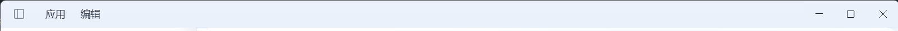
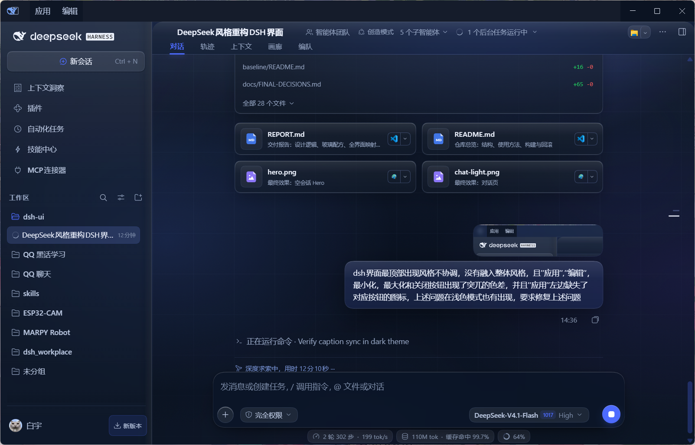
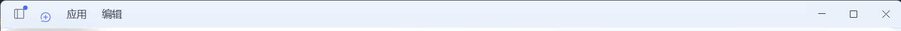

# REPORT — DeepSeek 网页端视觉语言在 DSH 上的落地

> 交付日期：2026-10-24 ｜ 基线：`baseline-v0`（施工前快照）｜ 实现：`dsh-skin-mistblue` 插件（已安装到 desktop profile）

## 0. 一句话结论

以 deepseek.com 的「雾蓝空气感 + 液态玻璃」为视觉基准，把 DSH Web GUI 全量重构为透明玻璃界面：
**画布透明 + 75px 网格 + 三处雾核光晕**，**三级可读性玻璃**（内容面 29% / 卡片 40% / 弹窗·详情 84.6% 填充），
卡片与浮层按「阅读优先级」分级加雾（6 / 16 / 24px，弹窗大面单独 12px），
并完整保留 DSH 原有交互、命中区与固定浮层行为。

## 1. 设计逻辑是怎么分析出来的

方法：对用户提供的 deepseek.com 首屏截图做逐像素反解（Pillow 墨迹包围盒、一阶差分找边、高通找网格、双背景反解 alpha），
再用 3 个独立锚点交叉验证 DPR=1.5（发送键 32px / 行高 14–20 / placeholder 16px），得到 1686×886 CSS 视口下的实测值。
完整过程与数值见 [`DESIGN-SPEC.md`](DESIGN-SPEC.md)（§2 为量化基线，§2.4 为 9 点取色表）。

提炼出的 6 条设计逻辑：

1. **单一强色**：整个页面只有一个高饱和色 —— DeepSeek 蓝（实测 `#4176e6`，官方 `#4D6BFE`）。发送键、选中、链接、focus ring 用它，其它全部是蓝灰色阶。
2. **空气感来自「大留白 + 低对比边界 + 雾化背景」**，不是来自细边框：参考图没有 1px 分隔线，层级靠 0.5px 发丝、弥散阴影和玻璃反光。
3. **背景是一张有结构的图**：顶部近白、右上雾核、左中雾带、底部中性白，外加 75px 工程网格（alpha≈0.045）；不是纯色/纯渐变。
4. **玻璃不是「模糊+半透明」，是 5 层叠加**：染色底 + 顶部镜面高光 + 霜（backdrop-filter）+ 内高光/发丝边 + 外投影（下节详述）。
5. **排版靠「一个大数字」**：Hero 48px/600/0.1em 标题（实测为粗黑体，非宋体），正文 14/24 保持紧凑；重心约 45–54%。
6. **交互克制**：圆角胶囊、hover 轻微抬亮/抬升、90–200ms 过渡；没有夸张动效与弹跳。

## 2. 玻璃逻辑：复用 wallpaper-engine 的提取

完整提取见 [`GLASS-SPEC.md`](GLASS-SPEC.md)（§1 配方、§2 公式、§3 表面登记、§5 陷阱、§6 契约）。
落地到本插件的核心是三条恒等式与一张三级表：

```
effAlpha = floor + a · (1 − floor)        floor = 0.45（浅）/ 0.59（深）× fidelity
五层      = fill + sheen + backdrop-filter + bevel/hairline + shadow
模糊与饱和度解耦：saturate 1.30 / brightness 1.04 / contrast 1.01 恒定
```

| tier | 用途 | 浅色 fill | 深色 fill | blur |
|---|---|---|---|---|
| L1 | 页面画布、内容容器、工具结果板 | 29% | 39% | 6px（仅小面；滚动容器不挂霜） |
| L2 | 侧栏、标题栏、气泡、输入卡、工具卡、右栏 | 40% | 55% | 16px |
| L3 | 弹窗、设置、详情卡、菜单、审批/计划/提问卡 | **84.6%** | **88.5%** | 24px（dialog 大面 12px） |

- **L3 地板不参与 fidelity 缩放**：用户明确要求「弹窗/显示卡/详情卡为了可读性增加卡面模糊」，阅读型浮层不能为了通透牺牲文字。
- 与 wallpaper-engine 的区别：WE 的 blur 反比于文字密度（内容面 20px、dialog 10px）；本插件按用户诉求改为**正比于阅读优先级**（L3 > L2 > L1），并在大 dialog 上保留低半径以免整窗重绘。
- 复用了 WE 的工程结论：`backdrop-filter` 会造成 fixed 包含块（composer 的霜挂 `::before`）、tooltip 的 `_bubble` 必须 `:not([role="tooltip"])`、菜单只走 `--dsw-specific-menu` token 通道、无 GPU 时 92% 近不透明降级。

## 3. 从首页推广到 DSH 全部界面

| DSH 界面 | 处理 |
|---|---|
| 主壳 frame / 三栏 | 全透明；仅中列一层 L1 白釉（顶部 20px 圆角），让氛围层成为唯一背衬 |
| Windows 标题栏 | `frame::before` 画底色 + `::after` 承载 L1 霜（伪元素无后代，不破坏 fixed 收起按钮） |
| 会话 header | 56 CSS px，L2 玻璃 + 1px 蓝灰发丝底边；tab 13px、蓝字 + 2.5px 圆角下划线 |
| 左栏 | `div:has(> [data-slot="sidebar"])::before` 承载 L2 霜 + 右缘发丝/内投影；新会话白釉胶囊、行 hover/选中蓝柔光、搜索胶囊 |
| 输入区 | 座位不铺底不挂霜；输入卡 L2 + 28px 圆角 + `::before` 霜；15px 输入、760 CSS 宽、蓝色圆形发送键、工具行胶囊、dock/goal bar 同宽 |
| Hero | 48px 标题 + 蓝鲸标 + 「预览版」蓝胶囊 + workspace/preset 胶囊 + 760 composer，重心 ~54% |
| 对话内容 | 用户气泡 L2（`:not([role=tooltip])` 全覆盖）、思考/工具折叠胶囊 L2、工具结果高不透明平板、代码块高不透明底 + sticky banner、行内码、deliverables/plan/轨迹卡 |
| 浮层 | dialog L3 + 12px 大面霜、提问/计划/审批卡 L3、菜单 token 通道 + 12px 圆角、tooltip 保持不透明深底白字、toast 实底、灯箱只修饰 chrome |
| 设置 | 整窗 L3 + 12px 霜、左导航胶囊、设置卡/表单 L2、插件管理/市场/详情卡 L2、右栏面板 L2 + 收起守卫、文档预览纸面 |
| 轨迹 | timeline 彩条保留、行 hairline、表格 L2 平板（不挂霜，保滚动性能） |

## 4. 实现架构

- 一个可安装的 DSH bundle：`dsh-skin-mistblue`（本地 link 安装到 desktop profile，已生效）。
- 无构建期依赖：CSS 源码在 `plugin/src/styles/*.css`，`node tools/build-plugin.mjs` 将其内联进 `plugin/lib/client.js`（内联样式表 + React 设置页）。
- 运行时：`html[data-dsg="on"]` 注入氛围层；通过 token 覆盖 + 少量稳定选择器（`[data-composer-card]`、`[data-slot="sidebar"]`、`[data-chat-flow]`、`[role="dialog"]`、`data-shortcut-modal=settings` 等）实现，不修改任何 DSH 自带包。
- 设置页：设置 → 外观 → **外观 · DeepSeek**，可调色彩模式（浅/深/跟随系统）、氛围背景（极光/轻雾/关）、玻璃透明度、模糊强度、动效开关，即时生效并存本机。
- 开发链路：改 CSS → build → client HMR 自动热更新（2–4s）；截图工具带**前台隐私守卫**（DSH 不在前台则拒绝截图）。
- 开发期使用的 DOM 快照/受控导航 hook 已在交付前移除（`lib/client.js` 现无 dev 代码），仓库保留 `tools/` 与 `docs/` 供复现。

## 5. 验证

实机截图（1603×1028，DPR 1.25）：

| 场景 | 截图 |
|---|---|
| 施工前（深色原生） | [`assets/final/before.png`](assets/final/before.png) |
| Hero（浅色） | [`assets/final/hero.png`](assets/final/hero.png) |
| 对话（浅色） | [`assets/final/chat-light.png`](assets/final/chat-light.png) |
| 对话（深色） | [`assets/final/chat-dark.png`](assets/final/chat-dark.png) |
| 设置 · 账号 | [`assets/final/settings-account.png`](assets/final/settings-account.png) |
| 设置 · 内置插件 | [`assets/final/settings-plugins.png`](assets/final/settings-plugins.png) |
| 轨迹页 | [`assets/final/trajectory.png`](assets/final/trajectory.png) |

已验证：浅/深双主题、Hero、对话、设置窗两页、插件卡网格、轨迹表、composer/goal bar/dock 布局、fixed 元素未错位、无横向滚动、无白底白字、代码/日志可读。
未实机验证（静态实现 + CSS 复核）：菜单/tooltip/toast、提问/计划/审批卡、图片灯箱、右栏文档预览、工具行展开详情、hover/focus 真实态、左栏收起态。原因：本会话无法可靠注入真实鼠标/键盘事件；可后续由人工或自动化测试补齐。

## 6. 回滚

1. **代码级**：`git checkout baseline-v0 -- .`（或切 tag `baseline-v0`）。
2. **界面级**：在 DSH 插件管理器停用/移除 `dsh-skin-mistblue`，刷新后恢复原生 UI。
3. **完整恢复**：用 `baseline/profile/` 覆盖 profile 的 `cordis.patch.yml`/`package.json`，用 `baseline/plugins/` 覆盖 liteglass 与 wallpaper-engine 配置，重启 DSH。
4. 颜色模式在本次改造中一次性切到浅色；如需深色，在 设置 → 外观 改回。

详见 [`OPERATIONS.md`](OPERATIONS.md)。

## 7. 已知问题与限制

- **dsh-pet 桌宠浮层**会遮挡左栏 brand/HARNESS 与部分对话内容；它是独立的透明置顶窗口（外部插件），本插件无法通过 CSS 控制，建议在 dsh-pet 设置里调整位置/大小。
- 顶部「应用 / 编辑」是 Windows 原生菜单栏，无法随主题玻璃化。
- 参考图真实 computed style 未能获取（deepseek.com 为 SPA，CSS 由 JS 注入），数值来自截图反解；`#4d6bfe` vs 实测 `#4176e6` 的差异保留在 `FINAL-DECISIONS.md §4`，改 `--dsg-blue` 单变量即可切换。
- 设置/深色最终截图拍摄于最后一次 60-settings 微调之前（差异为细节级），其余截图均基于最终构建。
- 菜单/tooltip/审批卡等未展开态未实机验证；代码按稳定 hook 与 token 通道实现，若宿主升级导致类名后缀变化，只需补 `docs/SURFACE-MAP.md` 白名单里的选择器。

## 8. 文档索引

- [`DESIGN-SPEC.md`](DESIGN-SPEC.md) — DeepSeek 视觉规格（实测基线、token、组件、验收）
- [`GLASS-SPEC.md`](GLASS-SPEC.md) — WE 玻璃/透明/模糊逻辑提取与移植契约
- [`SURFACE-MAP.md`](SURFACE-MAP.md) — DSH 60+ 表面 × 稳定选择器 × 玻璃等级
- [`FINAL-DECISIONS.md`](FINAL-DECISIONS.md) — 最终取舍（blur 方向、L3 地板、文字 ramp、品牌蓝、字体）
- [`UI-CONTRACT.md`](UI-CONTRACT.md) — 实现契约与硬约束
- [`OPERATIONS.md`](OPERATIONS.md) — 构建/安装/回滚
 
---

## 9. 追加修复：Windows 标题栏菜单条 / 窗口控制按钮（2026-10-24 第二轮）

用户反馈顶部 Windows 标题栏（「应用 / 编辑」菜单条 + 最小化/最大化/关闭）与整体风格脱节：
菜单条区域出现突兀色差、`应用` 左侧缺图标，浅色模式同样存在。

### 根因

- `应用 / 编辑` 不是网页 DOM，而是 DSH Desktop 的 preload 注入的 **Shadow DOM 菜单条**（`div[data-windows-menu]`），
  窗口控制按钮则是 Electron 的 `titleBarOverlay` 原生控件。
- preload 用一个隐藏探针 `<span>`（`background-color: var(--dsw-specific-sidebar-fill)`）通过 canvas 取色，
  经 `windowsAppearance` IPC 调 `setTitleBarOverlay(color, symbolColor)`。
- 我们把 `--dsw-specific-sidebar-fill` 改成半透明玻璃后，探针取到带 alpha 的颜色；原生 overlay 会把它合成到
  黑色背衬上 → 深色块。同时 preload 只在少量 mutation 时重测，主题切换后 overlay 常停留在启动时的颜色。

### 修复（`plugin/src/styles/12-windows-titlebar.css` + `client-template.js` 的 `syncDesktopCaption`）

1. **探针改为不透明主题色**（light `#eaf1fb` / dark `#0b1322`）：`setTitleBarOverlay` 收到不透明色，
   原生按钮区与页面标题栏同色。
2. **网页侧标题栏用同一实体色** + 轻微顶部釉光 + 0.5px 发丝底边；去掉原生条上的 backdrop-filter，
   三层（菜单区 / 控件区 / 网页条）不再有色差。
3. **主动重同步**：插件在启动后 250/700/1500/2800ms 以及主题切换（`data-ds-theme-source` /
   `data-ds-dark-theme`）后主动触发 preload 的探针重测（改写 body style 的 `--dsg-caption-tick`），
   确保 overlay 跟随当前主题，而不是启动时的旧值。
4. **补图标**：从 `@deepseek-ai/dsh-client-ui-primitives` 的 `FISH_LOGO_PATH` 提取官方鲸标，
   以 CSS mask 渲染在菜单条左侧（light `#4d6bfe` / dark `#7aaaff`），`应用` 左侧不再空缺。

### 验证（像素采样）

| 模式 | 左侧标题栏 | 右侧控件区 | 差值 |
|---|---|---|---|
| 浅色 | `rgb(235,242,251)` | `rgb(230,237,247)` | Δ≈5/255（页面釉光导致） |
| 深色 | `rgb(21,28,43)` | `rgb(14,22,37)` | Δ≈7/255 |





> 备注：`titleBarOverlay` 的最终颜色仍由 Desktop 主进程决定；本插件通过“不透明探针 + 主动重测”保证它
> 与玻璃 UI 同步。若 DSH Desktop 后续更新改了 preload 的探针实现，只需调整 12-windows-titlebar.css 的探针选择器。

### 9.1 追加反馈修复（第二轮）：菜单色块与图标

用户指出：
1. 「应用 / 编辑」背后的色块与标题栏背景不一致（偏白矩形）；
2. 左侧应使用截图所示的「分栏/侧栏」线条图标，而不是鲸标；线条颜色对齐主体风格、图标底与背景同色。

根因与修法：
- 色块来自 `50-overlays.css` 的 `html[data-dsg='on'] [data-windows-menu] { background-color: var(--dsw-alias-bg-layer-3) }`，
  它会命中 preload 注入的 Shadow DOM 菜单宿主，把 L3 白釉铺在标题栏上。
  在 `12-windows-titlebar.css` 内以 `background: transparent !important` 覆盖（12 先加载、50 后加载，因此必须带 `!important`）。
- 图标改为纯线条「panel left」SVG，通过 CSS mask 着色：浅色 `var(--dsg-blue)`（#4d6bfe），深色 `#7aaaff`；
  图标 18×18、位于菜单条左 42px，背景透明。
- 像素验证：浅色标题栏左侧 `rgb(235,242,251)`，菜单区同为 `rgb(235,242,251)`，右侧控件区 `rgb(230,237,247)`；三块已同色。


> 深色使用同一套规则（`#7aaaff` 线条 + `#0b1322` 标题栏），本次因用户正在输入未再次切换深色截图。

### 9.2 追加反馈修复（第三轮）：侧栏收起/展开态标题栏错位

用户反馈：收起/展开左侧边栏时，标题栏出现多余的蓝色线条（压在原生的「分栏」图标上、并挤到「应用」文字前）。

根因：
- 标题栏左侧 12px 处是 DSH 自带的**侧栏收起/展开按钮**（28×28 的 panel 图标），收起态 48px 处还有「新会话」按钮；
- `12-windows-titlebar.css` 之前在这两个位置自绘了同款线条图标，并且把 `--dsh-windows-menu-start` 固定成 54px，
  覆盖了 DSH 收起态的 84px —— 于是自绘图标压住原生 panel 图标、`应用` 压住「新会话」的 + 按钮。

修法：
- **删除自绘图标**，让 DSH 原生的 panel 图标与「新会话」按钮正常显示；
- 菜单起点只在**侧栏展开**时用 54px；收起时交回 DSH 的 84px：
  `html[data-dsg='on'][data-windows-titlebar]:not(:has([data-sidebar-collapsed='true'])) { --dsh-windows-menu-start: 54px; }`
- 菜单宿主继续保持透明背景（9.1 的修复不变）。

验证：
- 展开态：panel 图标（灰）→ `应用 编辑`，无重叠；
- 收起态：panel 图标（带蓝点）→ 新会话 + → `应用 编辑`，菜单正确右移，无重叠。




---

## 10. 对话页顶层 header 玻璃化（2026-10-24 第四轮，仓库标签 `v1.4-ui`）

### 10.1 诉求

用户把对话页顶部（会话标题 + 「智能体团队 / 创造模式 / 子智能体」chips + `对话/轨迹/上下文/画廊/编队` tab 行）
截图出来，要求这一层「添加跟输入框一样的透明效果、玻璃质感和模糊」。

### 10.2 为什么原来看起来是「白条」而不是玻璃

- header 原先已是 L2 配方：`--dsg-fill-l2`（≈39.8% 白）+ 顶部釉光 + `--dsg-backdrop-l2`。
  但它的**背后本身就是近纯白**（中列顶部白釉渐隐 + 氛围层顶部白光；实测 header 内 `#FEFEFE`，
  而正下方内容区已经是 `#DDE8F7`）——玻璃没有可透出的底色，奶油白 fill 再叠一层白，只剩一条白板。
- 几何上它是通栏平贴条：没有外投影、没有圆角，与内容区之间只靠一根 1px 发丝线，
  所以即使有霜也读不出「一层玻璃浮在氛围上」的层次。

### 10.3 做法（只动 `plugin/src/styles/10-shell.css`）

1. **给玻璃一条能透视的衬底**（§1）：中列顶部原来那道纯白釉渐隐，换成两团淡蓝雾
   （`radial-gradient` 18% / 82% 位置）+ 极淡白釉。它同时是氛围层的一部分和 header 的 backdrop，
   header 内采样因此变成 `#E4EEFF / #DFECFF`（比周围 `#EAF2FF` 更蓝、更透）——透明与模糊终于可见。
2. **header 改成悬浮玻璃条**（§3）：
   - 外槽 `9px 12px 8px` 内缩 + 本体 `18px` 圆角：四周露出氛围层，和 composer 一样「浮在雾上」；
   - 填充改用 header 自己的变量：浅色 17% 白、深色 47% `#0d1524`；霜 `blur(24px) saturate(1.65)`；
   - 三件套全在 `::before`（唯一载体，负 z-index，不产生 fixed 包含块）：
     顶部 0.72 白镜面 + 0.5px 白釉发丝边 + 底部内侧极淡蓝影（玻璃厚度）；
   - 本体只画外投影 `0 20px 46px -30px`（浅色蓝调 / 深色黑），与 composer 的 elevation 语言一致；
   - tab 行、动作按钮、crumb 原有规则全部照旧（仍可点、仍可拖窗），只改了外壳材质与几何。
3. **深色同构**：`--dsg-header-fill` / `--sweep` / 投影各出一套暗色值，其余规则共用。
4. **退化与边界**：`max-width: 760px` 收边（8px / 14px 圆角）；`@supports not (backdrop-filter)`
   与软件光栅化（`[data-dsg-fallback]`）回退到 94% 近不透明，几何不变。

### 10.4 验证

| 场景 | 截图 |
|---|---|
| 浅色·对话页顶层（1603×1028，DPR 1.25） | [`assets/final/chat-light-glass-header.png`](assets/final/chat-light-glass-header.png) |
| 深色·对话页顶层 | [`assets/final/chat-dark-glass-header.png`](assets/final/chat-dark-glass-header.png) |
| 浅色·header 细部 | [`assets/final/header-glass-light.png`](assets/final/header-glass-light.png) |
| 深色·header 细部 | [`assets/final/header-glass-dark.png`](assets/final/header-glass-dark.png) |

- 浅/深两套均实机 HMR 验证（深色通过临时改 profile 的 `ui-theme.preference` 截图后已改回 `light`）。
- tab 选中下划线、hover 底、右侧「打开方式 / 更多 / 侧栏」按钮位置与点击区域不受影响；
  外层只有 `::before`（`pointer-events: none`）承担霜，不含任何 fixed 后代。
- 深色采样：header 内比周围背景亮约 6–10/255、蓝通道 +8，读作暗色玻璃；浅色 header 内 `#E4EEFF`、周围 `#EAF2FF`。

> 取舍：这是**有意的几何改动**（通栏平贴条 → 内缩悬浮条），因为「像输入框」的核心就是
> 「一块独立、有厚度、浮在氛围上的玻璃」。若后续想回到通栏，只需去掉 §3 外槽 padding 与圆角，
> 保留 §1 的衬光和 §3 的填充/投影即可。

---

## 11. 右侧边栏玻璃化（2026-10-24 第五轮，仓库标签 `v1.5-ui`）

### 11.1 诉求

右栏（文件浏览器 / 上下文洞察，含打开某个 tab 后的界面）要和对话区**共享同一张背景**：
不再是一块不透明白板，而是玻璃面 —— 透明、有霜（模糊），文字/图表仍清晰。

### 11.2 根因：三层叠白

- **双层玻璃**：面板壳同时被两处画了玻璃 —— `60-settings.css §4` 在面板元素上铺
  `fill-l2 + sheen-l2 + backdrop-l2`，`10-shell.css §4` 又在它的 `::before` 上铺了同一套。
  fill 叠两次 ≈ 64% 白，再加釉光。
- **dockkit 中间层叠底**：`.OUqwTW_panelBody`、`_surface_*`、`_tabHost`、`_paneBody`、`_tabCell`
  这些容器各自带 `--dsw-alias-bg-base` / `--dsw-alias-bg-layer-*` 半透明底，层层叠在壳上；
  文件浏览器 / 上下文插件自身还有 bg-layer 卡片。
- 结果：右栏实测 `#FDFEFF`（几乎纯白），而旁边对话区是 `#DDEEF6` —— 背景完全脱钩。

### 11.3 做法（只改 `60-settings.css §4` + `10-shell.css §4`）

1. **玻璃只画一层**：面板本体改为透明、不挂霜；`::before` 仍按契约做唯一载体
   （负 z-index、无 fixed 后代），并新增面板专属变量
   `--dsg-panel-fill / --dsg-panel-backdrop`（浅 18% 白、深 46% `#0d1524`；`blur(22px)` + saturate）。
2. **清掉 dockkit 中间层**：`[data-dockkit-surface|host|pane|content]` 与
   `[class*="_panelBody|_tabLayout|_tabCell|_tabHost|_paneBody"]` 全部 `background: transparent !important`
   —— 让氛围层透上来，只留面板壳这一层霜。
3. **保留内容可读性**：文件列表/上下文卡片本来就吃 `--dsw-alias-bg-layer-*`（29.3% / 39.8% 白），
   在玻璃壳上自然形成「玻璃上的玻璃卡」；图表、代码、文档预览继续用它们自己的实底，
   文档预览仍是纸面（不参与玻璃化，保证长文可读）。
4. **全屏右栏仍走 L3**：只把 `--dsg-panel-fill/-backdrop` 换成 L3 值，本体不动。
5. **关闭态**：`aria-hidden=true` 时元素与 `::before` 全部清干净（容器常驻布局）。

### 11.4 验证

| 场景 | 截图 |
|---|---|
| 浅色·右栏文件浏览器 | [`assets/final/right-panel-files-glass.png`](assets/final/right-panel-files-glass.png) |
| 浅色·右栏上下文洞察 | [`assets/final/right-panel-context-glass.png`](assets/final/right-panel-context-glass.png) |
| 深色·右栏文件浏览器 | [`assets/final/right-panel-files-glass-dark.png`](assets/final/right-panel-files-glass-dark.png) |
| 深色·右栏上下文洞察 | [`assets/final/right-panel-context-glass-dark.png`](assets/final/right-panel-context-glass-dark.png) |

- 浅色采样：右栏内 `#EAF2FC`（同高度的对话区 `#CFDEF2`，同色系、更亮）——氛围层确实透上来了，
  面板不再自成一块白板；顶部因 sheen 略亮，向左下渐隐。
- 深色同构（`#0d1524` 46% + 22px 霜），卡片/图表/文字对比度保持；tab 胶囊、关闭、全屏按钮均可用。
- 深色验证方式：临时把 profile 的 `ui-theme.preference` 改为 `dark` 截图，随后已改回 `light`。

> 注意：右栏的「打开某文件后的文档/代码预览」按设计仍是实底纸面（§5），
> 那是阅读面，不跟随玻璃化；只有面板外壳、tab 条、列表与统计卡走玻璃。

---

## 12. 拖拽分栏卡顿优化 + 设置页中文（2026-10-24 第六轮，仓库标签 `v1.6-ui`）

### 12.1 现象与根因

用户拖动左右分栏边界改变宽度时明显卡顿。根因是**每帧重排 × 大面积 backdrop-filter**：

- 拖动期间宿主每帧改列宽 → 对话内容（气泡、turn trigger）、左栏、右栏、header、composer
  全部参与重排/重绘；
- 本插件让这些面都吃 `backdrop-filter`（气泡甚至逐个挂霜）。Chromium 对每个
  `backdrop-filter` 表面都要**重新采样 backdrop 再做模糊**，一帧里几十个面同时重算，
  合成器直接掉帧；
- 侧栏/header 还有沿移动边缘的 44px 级外投影，每帧重新栅格化。

### 12.2 做法：拖动期间降级为「平价材质」

1. **client 半部新增 resize guard**（`plugin/src/client-template.js`）：
   - `pointerdown` 后等到指针位移 > ~4px 才判定为「拖动」（点击不触发），
     给 `<html>` 打 `data-dsg-resizing`；`pointerup / pointercancel / blur / 15s 安全超时`
     立刻移除。
   - 不依赖具体手柄选择器，因此左栏边界、dockkit divider、任何布局拖动都覆盖。
2. **样式半部只在这一状态下卸成本**（`plugin/src/styles/00-foundation.css`）：
   - 气泡 / turn trigger：`backdrop-filter: none`，同时去掉 44px 外投影、保留内侧顶光与发丝边；
   - composer、goal bar、右栏、会话 header、左栏的 `::before`：`backdrop-filter: none`；
   - 侧栏/header 外投影收紧到 16–20px。
3. **为什么不算视觉退化**：这些玻璃的 backdrop 都是平滑的氛围层（固定渐变 + 极淡网格），
   有霜/无霜在拖动的那几百毫秒里几乎无差；**松手后的每一帧与原来完全一致**，
   静态截图与拖动结束后外观不变（只影响拖动过程）。

### 12.3 设置页改中文

- 根因：`T(zh, en)` 在**模块加载时**就把语言缓存成常量，而本插件以 `immediately: true` 加载，
  经常早于 DSH locale 服务把 `<html lang>` 同步成 `zh-CN`；此时只能退到
  `navigator.language`（Electron 常为 en-US），于是设置行显示英文，而导航标题却是中文。
- 修法：`currentLanguage()` 改为**每次求值**：优先读 DSH `locale` 服务的
  `getSnapshot().active`，其次 `<html lang>`，再次 `navigator.language`，最后默认 `zh`；
  `T()` 不再缓存。同时订阅 `locale/change`，语言切换后设置页立即重渲染。
- 效果：DSH 界面是中文时，插件设置区（标题/配色/氛围背景/玻璃透明度/模糊强度/动效/恢复默认）
  全部中文；切到 English 时自动跟随为英文。

### 12.4 验证方式

- 新增 `tools/test-plugin-logic.mjs`（`node tools/test-plugin-logic.mjs`）：
  从源码中原样切片 `initResizeGuard / currentLanguage / isZh / T`，
  用 mock DOM 断言：
  - 点击（位移 <4px）不触发、拖动触发、松手清除、disposer 清干净；
  - `lang=zh-CN → 中文`、`lang=en → English`、locale 服务 `zh → 中文`（即使 navigator 是 en）、无信号默认中文。
  全部 PASS。
- 选择器侧的 `[data-dsg-resizing]` 规则只作用于现有稳定 hook
  （`[class*='_bubble']`、`[data-turn-trigger]`、`[data-composer-card]`、`[data-slot='conversation.header']`、
  `div:has(> [data-slot='sidebar'])`、`[data-sidebar-right-panel]`），与 §10/§11 同一套 hook。
- 本轮环境限制：DSH 桌面端当前为**非 development 启动**（菜单里没有「刷新页面」），
  插件 client 的 HMR 通道在最近一次重启后不再推送；因此新 bundle 需要**下一次启动/重载页面**
  才能在界面上看到。`plugin/lib/client.js` 已是最新构建（141.9 KiB）。

---

## 13. 定名与改包名：`dsh-skin-mistblue`（雾蓝，2026-10-24 第七轮，`v1.7-ui`）

用户选定皮肤名 **dsh-skin-mistblue / 雾蓝（Mistblue）**，从原工程名 `dsh-ui-deepseek` 迁移：

### 13.1 改动清单

| 位置 | 改动 |
|---|---|
| `plugin/package.json` | `name: dsh-skin-mistblue`，description 改为 Mistblue 皮肤 |
| `plugin/cordis.patch.yml` | Host 行 `id: mistblue` / `name: dsh-skin-mistblue`（顺带清掉旧文件里的乱码注释） |
| `plugin/src/client-template.js` | 模块 id、`data-plugin*`、effect 标签、`settings.section` id、设置页标题（「外观 · 雾蓝」/「雾蓝玻璃外观」）全部切换 |
| `plugin/locale/{zh,en}.json` | title / description 改为雾蓝 / Mistblue |
| `plugin/lib/index.js` | Host half 注释更新 |
| profile `desktop` | `plugin_manager` 重新以 link 方式安装 `dsh-skin-mistblue`，移除旧 `dsh-ui-deepseek` |
| 文档 | README / REPORT / OPERATIONS / UI-CONTRACT / GLASS-SPEC 全量改名；NAMING 记录决策 |

### 13.2 配置迁移（不丢旧设置）

- 新键：`dsh-skin-mistblue/config`、`dsh-skin-mistblue/color`；
- `readItem(新键, 旧键)`：新键缺失时回退读 `dsh-ui-deepseek/config`、`/color`；
- 首次保存/切主题后写入新键并删除旧键，避免两份配置漂移。

### 13.3 验证

- `node tools/test-plugin-logic.mjs` 仍 9/9 PASS（改名不影响 guard/i18n 逻辑）；
- 构建通过，bundle 由 10 个 CSS 文件 + 模板生成；
- **实时插槽校验**（`cordis_inspect_query` → client `Slots.listSubTree settings.section`）：
  occupant 已是 `{ id: "dsh-skin-mistblue", order: 60, active: true }`，旧的
  `dsh-ui-deepseek` 已从 occupant 列表消失 —— 说明新 client 半部已经加载、设置区注册成功。
- 安装侧：`plugin_manager install_bundle` 返回 `application: applied`；旧 bundle 先从
  profile 依赖里移除（`pnpm remove dsh-ui-deepseek`）后不再 removable（即已清空），
  并清掉了残留的 `node_modules/dsh-ui-deepseek` junction（目标仍指向本仓库 `plugin/`）。
- 设置页入口文案变为「外观 · 雾蓝」，locale 中文标题「雾蓝 · Mistblue」。

> 注意：改名涉及 `package.json` 与 bundle 行，属于 host 侧元数据；如果 DSH 不是
> development 启动，渲染进程不会自动重载，最坏情况下需要重启一次 DSH 才能看到新设置项名称。

---

## 14. 收起态标题栏三处问题（2026-10-24 第八轮，`v1.8-ui`）

用户反馈收起侧栏后：
1. 「应用」左边的「新建会话」按钮图案错位、颜色过于突出；
2. 「展开/折叠」图标右上角多出一个不知名蓝色圆点；
3. 悬停这两个选项时出现一块黑色阴影，疑似“详情页窗口没显示”。

### 14.1 根因

| 症状 | 根因 |
|---|---|
| + 号错位/过蓝 | 收起态两个按钮是宿主用 `position:fixed; left:12px/48px; width:28px;height:28px` 钉在标题栏里的；但我们的基础规则 `button[class*='_newSession']` 给了 `height:38px`、`margin`、12px 圆角，且 `+` 号 svg 颜色是品牌蓝。高优先级的基础规则把宿主 28×28 的几何顶歪，图标也随之溢出/下沉。 |
| 蓝点 | 收起按钮内有一个 DSH 的「桌面更新」徽标插槽 `sidebar.toggle.badge`（`ui-settings-general` 的 `DesktopUpdateBadge`，`_badge` 6px 圆形、品牌蓝、绝对定位 top/right 2px）。它在收起态一直显示，对用户来说是个含义不明的点。 |
| “黑色阴影” | 不是阴影，也不是丢窗口：它是这两个按钮的 **tooltip**（「打开侧边栏 Ctrl+B」/「新建会话 Ctrl+N」）。tooltip 渲染在**侧栏列的层叠上下文里**，而新的悬浮 header 是一条带霜的玻璃条、层级更高，把 tooltip 盖住并染色 → 只剩边缘透出的一圈灰黑色，看起来像阴影。用 `[role='tooltip']{background:#f03}` 探针验证：整条 header 被染红，确认 tooltip 就在玻璃后面。 |

### 14.2 修法

1. `20-sidebar.css §7`：收起态的 `_newSession` 完全交回宿主几何
   （`28×28`、`margin/padding/border:0`、`8px` 圆角、透明底），图标与 panel 图标同尺寸（16px）、
   颜色改 `--dsw-alias-label-secondary`；hover 才用 `--dsg-row-hover` 与主墨色。
   （品牌蓝的 + 号只保留在展开态的主 CTA 胶囊里。）
2. 收起态隐藏更新徽标：`[data-sidebar-collapsed] … button[class*='_toggle'] [class*='_badge'] { display:none }`；
   更新提示仍保留在展开态 footer 的「新版本」胶囊，功能不丢。
3. 新增 `21-collapsed-titlebar.css`：**只在 tooltip 真的挂载时**把侧栏列提升到悬浮 header 之上
   （`div:has(> [data-slot='sidebar']):has([role='tooltip']) { z-index:120 }`），
   让 tooltip 正常浮在最上层，静止态层次与玻璃外观不变。

### 14.3 验证

- 浅色：收起态两个图标对齐、无蓝点；悬停分别得到完整的深色 tooltip（不是灰影）。
- 深色：同构通过，tooltip 浮在暗色玻璃 header 之上、白字清晰。
- 展开态：胶囊按钮/品牌行/footer 均不受影响；`node tools/test-plugin-logic.mjs` 仍 9/9 PASS。

| 场景 | 截图 |
|---|---|
| 浅色·收起态标题栏（无蓝点、+ 号对齐） | [`assets/final/collapsed-titlebar-light.png`](assets/final/collapsed-titlebar-light.png) |
| 浅色·悬停 tooltip（不再是墨影） | [`assets/final/collapsed-titlebar-tooltip-light.png`](assets/final/collapsed-titlebar-tooltip-light.png) |
| 深色·悬停 tooltip | [`assets/final/collapsed-titlebar-tooltip-dark.png`](assets/final/collapsed-titlebar-tooltip-dark.png) |

---

## 15. 悬停 tooltip 全面玻璃化（2026-10-24 第九 / 十轮，`v1.9-ui` → `v1.10-ui`）

用户反馈上下文趋势图的悬停详情卡"文字重叠看不清"，并要求把**所有**"光标悬停弹出、
移走消失"的 tooltip 统一改成与整体一致的玻璃质感（透明 + 模糊 + 字要看清）。

### 15.1 根因

1. **图表详情卡**：dsh-context 的 `.lc-chart-tip` / `.lc-tip` 用
   `background: var(--dsw-alias-bg-layer-2)`（我们把它映射成 39.8% 白）且**不挂霜**，
   底下坐标轴、网格与堆叠面积直接透出来；同时它的 `z-index` 只有 5，
   旁边的坐标文字/标记会画到卡片上 → 看起来像"两行字叠在一起"。
2. **DSH 原生 tooltip**：`[role='tooltip']` 被 §5 故意设成"不透明深底白字"（GLASS-SPEC #161
   的历史结论：玻璃化会把白字压成低对比）。用户明确要求玻璃风格后，这条旧策略必须反转。

### 15.2 修法（`50-overlays.css §5`）

- 新增共享配方 `--dsg-tip-fill / --dsg-tip-fill-chart / --dsg-tip-ink / --dsg-tip-shadow`：
  - 原生 tooltip：浅 94% 白 / 深 94% `#0d1524` + `blur(16px) saturate(1.45)` + 釉 + 0.5px 发丝边；
  - 图表卡加厚到 **96%**、霜 ×1.1，并 `z-index: 40`（压住绘图标记）；
  - 文字统一 `--dsg-tip-ink = --dsw-alias-label-primary`；快捷键 pill 改中性底，不再是白字压深底；
- 覆盖范围：`[role='tooltip']`、`.lc-tip`、`.lc-chart-tip`、`[class*='_chart-tip']`、`[class*='_chartTip']`；
- 无 `backdrop-filter` 环境：填充率提到 98%，保证仍然挡得住背景；
- **悬停预览卡（HoverCard）不动**：文件/会话预览里有图片，玻璃化会把预览洗白，保持宿主材质。

> 填充率两轮调整：v1.9 先用 74%/78%（保留更多透明感），用户反馈仍偏透，v1.10 改成
> **94%/96% 几乎不透明**——玻璃只剩 ~4% 的通透与霜/釉/发丝边，底下 12px 坐标文字彻底不透出，
> 这也是"能看清字"的最终取舍。

### 15.3 验证

- HMR 已把新 CSS 推到运行中的实例（构建 11 CSS / 149.3 KiB，`tools/test-plugin-logic.mjs` 9/9 PASS）。
- 实机窗口当时被其他应用（Arduino / QQ）覆盖，鼠标输入不可达，改用**同一套真实 CSS 的验证台**：
  `tools/tooltip-preview.mjs` 生成 `.ref/tip-preview/{light,dark}.html`，按与 DSH 相同的顺序加载
  baseline 主题 → dsh-context 宿主 CSS → `plugin/src/styles/*.css`，用 headless Edge 以 2x 渲染截图。
  这样验证的是"宿主规则 + 我们的覆盖"的**真实层叠结果**，而不是手写 mock。

| 场景 | 截图 |
|---|---|
| 浅色·图表悬停卡（几乎不透明玻璃，坐标字不再透出） | [`assets/final/tooltip-glass-light.png`](assets/final/tooltip-glass-light.png) |
| 深色·同上 | [`assets/final/tooltip-glass-dark.png`](assets/final/tooltip-glass-dark.png) |

---

## 16. 收尾与发布（`v1.0.0`）

第十轮收尾把十次界面迭代整合成可发布的 `dsh-skin-mistblue@1.0.0`：

### 16.1 发布物料

| 文件 | 作用 |
|---|---|
| `LICENSE` + `plugin/LICENSE` | MIT（2026 HewangLan0511），npm 包内读取 `plugin/LICENSE` |
| `CHANGELOG.md` | 1.0.0 与 v1.0-ui → v1.10-ui 全部里程碑 |
| `docs/RELEASE.md` | npm / GitHub 发布清单（含登录、tag、Release 附件、验收、回滚） |
| `plugin/README.md` | npm 包页面说明（安装 / 设置 / 许可） |
| `plugin/package.json` | `1.0.0`、`license: MIT`、`private` 移除、`keywords` / `files` 补全 |
| `tools/release.mjs` | 构建 → 测试 → `npm pack` → `git archive` 源码 zip → SHA-256 |

### 16.2 产物

```powershell
node tools/release.mjs
# dist/dsh-skin-mistblue-1.0.0.tgz
# dist/dsh-skin-mistblue-1.0.0-src.zip
# dist/SHA256SUMS.txt
```

`dist/` 已加入 `.gitignore`；发布到 npm 与 GitHub Release 的步骤见 `docs/RELEASE.md`。
本机 npm 未登录、没有 `gh`/SSH key、仓库无 remote，因此**最后两步上传需要账号侧操作**，
其余（版本号、许可证、包内容、构建产物）已就绪。

### 16.3 版本与标签

- npm / 插件版本：`1.0.0`；
- git tag：`v1.0.0`（发布提交），历史界面里程碑 `v1.0-ui` … `v1.10-ui` 全部保留；
- profile 内 bundle 同步升级为 `1.0.0`（`plugin_manager install_bundle`），设置页入口不变。


